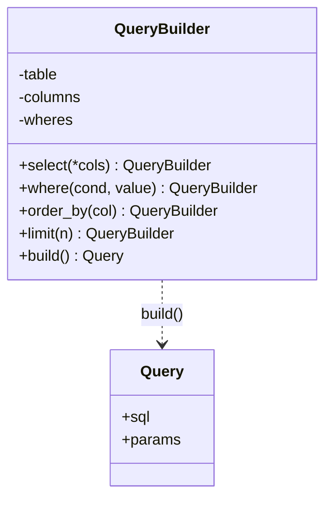

# Builder

> **Nhóm:** Creational · [← Mục lục](../README.md)

**Một câu:** Tách việc **lắp ráp một object phức tạp** ra thành **từng bước**, để cùng một quy trình có thể tạo ra nhiều cấu hình khác nhau.

**Ví dụ đời thường:** Đặt bánh mì kẹp: chọn bánh, chọn nhân, thêm rau, thêm sốt. Bước nào bỏ qua cũng được, còn người làm bánh (builder) lo xếp đúng thứ tự.

---

## 1. Problem

Cần tạo câu SQL với nhiều phần tùy chọn: cột, điều kiện, sắp xếp, giới hạn.

```python
# Cách 1: constructor "khổng lồ"
q = Query("users", ["id", "name"], ["age > ?"], [18], None, "name", True, 10, None)
#   ↑ Đọc xong không ai biết None thứ 5, True thứ 7 nghĩa là gì

# Cách 2: tự nối chuỗi trong mỗi hàm tìm kiếm
sql = "SELECT id, name FROM users"
if min_age:
    sql += " WHERE age > ?"
if city:
    sql += " AND city = ?"     # 🐛 Lỗi khi min_age rỗng: "...FROM users AND city = ?"
sql += " LIMIT 10"
```

- Object có **nhiều phần tùy chọn**, và các phần phải ghép **đúng thứ tự**.
- Logic lắp ráp bị **lặp lại** ở mọi nơi cần tạo query, và dễ sai.

## 2. Solution

1. Tách việc lắp ráp ra **một class riêng** (Builder).
2. Mỗi phần là **một method** (`select`, `where`, `limit`...). Method trả về `self` để gọi nối tiếp được (*fluent interface*).
3. Method `build()` **kiểm tra rồi ghép** tất cả theo đúng thứ tự, trả về object kết quả.



## 3. Code

```python
from dataclasses import dataclass


@dataclass(frozen=True)
class Query:                         # Product: object kết quả, bất biến
    sql: str
    params: tuple


class QueryBuilder:
    def __init__(self, table: str):
        self._table = table
        self._columns: list[str] = ["*"]
        self._wheres: list[str] = []
        self._params: list = []
        self._order: str | None = None
        self._limit: int | None = None

    def select(self, *columns: str) -> "QueryBuilder":
        self._columns = list(columns)
        return self                                  # trả về self → gọi nối tiếp được

    def where(self, condition: str, value) -> "QueryBuilder":
        self._wheres.append(condition)
        self._params.append(value)                   # dùng placeholder ?, tránh SQL injection
        return self

    def order_by(self, column: str, desc: bool = False) -> "QueryBuilder":
        self._order = f"{column} {'DESC' if desc else 'ASC'}"
        return self

    def limit(self, n: int) -> "QueryBuilder":
        if n <= 0:
            raise ValueError("limit phải > 0")      # validate ngay tại từng bước
        self._limit = n
        return self

    def build(self) -> Query:
        # Builder chịu trách nhiệm ghép ĐÚNG THỨ TỰ, client không cần quan tâm
        sql = f"SELECT {', '.join(self._columns)} FROM {self._table}"
        if self._wheres:
            sql += " WHERE " + " AND ".join(self._wheres)
        if self._order:
            sql += f" ORDER BY {self._order}"
        if self._limit:
            sql += f" LIMIT {self._limit}"
        return Query(sql, tuple(self._params))


# ----- Client: đọc như một câu văn -----
query = (
    QueryBuilder("users")
    .select("id", "name")
    .where("age > ?", 18)
    .where("city = ?", "Hà Nội")
    .order_by("name")
    .limit(10)
    .build()
)
print(query.sql)
# SELECT id, name FROM users WHERE age > ? AND city = ? ORDER BY name ASC LIMIT 10
print(query.params)   # (18, 'Hà Nội')


# ----- Lắp ráp có điều kiện: WHERE/AND luôn đúng -----
def search_users(min_age: int | None = None, city: str | None = None) -> Query:
    builder = QueryBuilder("users")
    if min_age:
        builder.where("age > ?", min_age)
    if city:
        builder.where("city = ?", city)
    return builder.build()

print(search_users(city="HCM").sql)   # SELECT * FROM users WHERE city = ?
```

> **Director** (tùy chọn): một class hoặc hàm chứa các "công thức" build có sẵn, ví dụ `active_users_query()`. Dùng khi cùng một chuỗi bước được lặp lại ở nhiều nơi.

### Pythonic hơn: đôi khi không cần Builder

Nếu chỉ là **nhiều tham số tùy chọn**, Python đã có keyword arguments, giá trị mặc định và `@dataclass`:

```python
@dataclass
class EmailConfig:
    host: str
    port: int = 587
    use_tls: bool = True
    timeout: int = 30

cfg = EmailConfig("smtp.gmail.com", timeout=10)   # đã rõ ràng, không cần Builder
```

Builder chỉ đáng dùng khi object phải **lắp từng bước hoặc có điều kiện**, có **ràng buộc thứ tự**, hoặc cần **kiểm tra trước khi tạo**.

## 4. Trade-offs

| ✅ Ưu điểm | ❌ Nhược điểm |
|---|---|
| Code tạo object dễ đọc (fluent interface) | Thêm class và nhiều code hơn |
| Lắp ráp từng bước, có điều kiện, đúng thứ tự | Quá mức cần thiết với object đơn giản (Python đã có kwargs) |
| Kiểm tra dữ liệu trước khi tạo, product có thể bất biến | Builder giữ state thay đổi được, không nên dùng chung giữa nhiều thread |
| Cùng một quy trình có thể sinh nhiều biểu diễn (SQL cho MySQL hoặc Postgres) | |

- **Nên dùng khi:** object có nhiều phần tùy chọn và phải lắp ráp theo quy trình, ví dụ query, HTTP request, tài liệu, báo cáo.
- **Không nên dùng khi:** object chỉ có vài tham số và tạo trong 1 bước.

## 5. Ngoài thực tế

- SQLAlchemy: `select(User).where(User.age > 18).order_by(User.name).limit(10)`.
- Django ORM: `User.objects.filter(age__gt=18).order_by("name")[:10]`.
- Java: `StringBuilder` và annotation `@Builder` của Lombok.
- **Dễ nhầm với:** Factory Method. Factory Method chọn *class nào* rồi tạo trong 1 bước; Builder *lắp ráp* object qua nhiều bước.

---

[← Factory Method](factory-method.md) · [Mục lục](../README.md) · [Adapter →](../02-structural/adapter.md)
