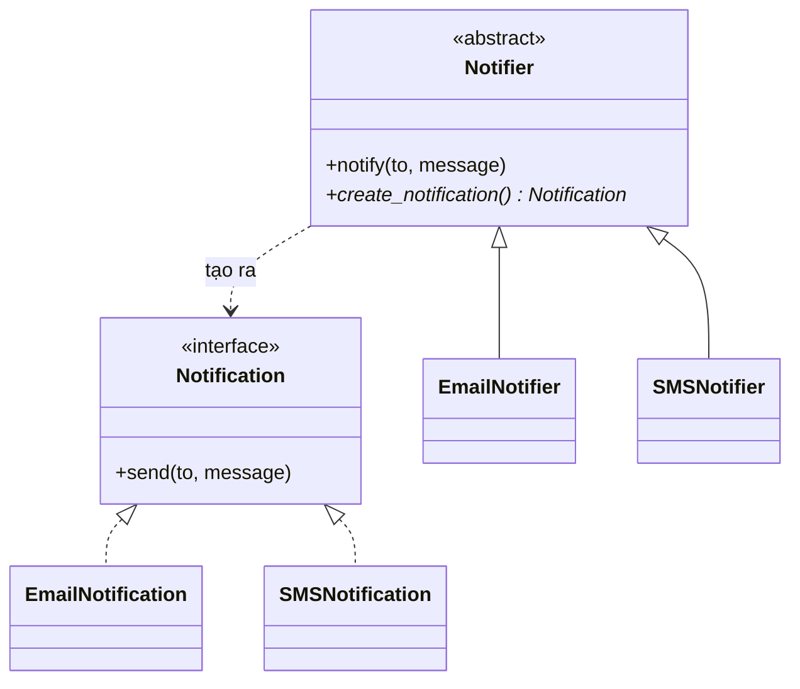

# Factory Method

> **Nhóm:** Creational · [← Mục lục](../README.md)

**Một câu:** Định nghĩa một method để **tạo object** ở class cha, và để **subclass quyết định** tạo object của class cụ thể nào.

**Ví dụ đời thường:** Một chuỗi nhà hàng có chung quy trình phục vụ: nhận order, làm món, mang ra bàn. Còn *món cụ thể* do từng chi nhánh tự quyết: chi nhánh Ý làm pizza, chi nhánh Việt làm phở.

---

## 1. Problem

App cần gửi thông báo cho khách. Ban đầu chỉ có email, sau đó thêm SMS:

```python
class OrderService:
    def confirm(self, channel: str, to: str):
        if channel == "email":
            sender = EmailSender(smtp_host="smtp.gmail.com", port=587)
        elif channel == "sms":
            sender = SMSSender(api_key="...")
        else:
            raise ValueError(f"Kênh không hỗ trợ: {channel}")
        sender.send(to, "Đơn hàng đã được xác nhận")

# Khối if/elif này bị copy sang PaymentService, ShippingService, MarketingService...
```

- Thêm kênh Zalo thì phải sửa **tất cả** các khối if/elif đó.
- Logic nghiệp vụ (`confirm`) bị trộn với logic khởi tạo (host, port, api_key).

## 2. Solution

1. Tạo **interface chung** cho mọi loại sản phẩm (`Notification`).
2. Class cha (`Notifier`) chứa logic nghiệp vụ và **gọi một method trừu tượng** `create_notification()` thay vì gọi trực tiếp `EmailSender()`.
3. Mỗi **subclass override** method đó để trả về sản phẩm cụ thể.



## 3. Code

```python
from abc import ABC, abstractmethod


# ----- Product: interface chung của mọi loại thông báo -----
class Notification(ABC):
    @abstractmethod
    def send(self, to: str, message: str) -> None: ...


class EmailNotification(Notification):
    def send(self, to, message):
        print(f"📧 Email → {to}: {message}")


class SMSNotification(Notification):
    def send(self, to, message):
        print(f"📱 SMS → {to}: {message}")


# ----- Creator: chứa logic nghiệp vụ + khai báo factory method -----
class Notifier(ABC):
    @abstractmethod
    def create_notification(self) -> Notification:    # ← factory method
        ...

    def notify(self, to: str, message: str) -> None:
        # Logic dùng chung (format, log, retry...). Không biết class cụ thể nào được tạo
        notification = self.create_notification()
        notification.send(to, f"[MyShop] {message}")


# ----- Concrete Creators: mỗi subclass quyết định tạo product nào -----
class EmailNotifier(Notifier):
    def create_notification(self):
        return EmailNotification()


class SMSNotifier(Notifier):
    def create_notification(self):
        return SMSNotification()


# ----- Client: chỉ làm việc với Notifier -----
def confirm_order(notifier: Notifier, to: str):
    notifier.notify(to, "Đơn hàng #123 đã được xác nhận")

confirm_order(EmailNotifier(), "an@example.com")   # 📧 Email → an@example.com: [MyShop] Đơn hàng #123 ...
confirm_order(SMSNotifier(), "0901234567")         # 📱 SMS → 0901234567: [MyShop] Đơn hàng #123 ...
```

**Muốn thêm kênh Zalo?** Chỉ cần viết thêm `ZaloNotification` và `ZaloNotifier`, không phải sửa dòng code cũ nào.

### Pythonic hơn: Simple Factory với dict

Trong Python, class là object và gọi được như hàm. Vì vậy khi cần chọn class theo input hoặc config, một dict là đủ:

```python
NOTIFICATIONS: dict[str, type[Notification]] = {
    "email": EmailNotification,
    "sms": SMSNotification,
}

def create_notification(channel: str) -> Notification:
    return NOTIFICATIONS[channel]()        # thêm kênh mới = thêm 1 dòng vào dict

create_notification("sms").send("0901234567", "Xin chào")
```

Đây là **Simple Factory**, chưa phải Factory Method chuẩn GoF, nhưng là cách phổ biến nhất trong code Python. Factory Method (dùng subclass) hợp hơn khi bạn viết **framework hoặc thư viện** và muốn người dùng tự override cách tạo object.

## 4. Trade-offs

| ✅ Ưu điểm | ❌ Nhược điểm |
|---|---|
| Tách việc *tạo* object khỏi việc *dùng* object (loose coupling) | Thêm nhiều class: mỗi product cần thêm 1 creator |
| Open/Closed: thêm loại mới không sửa code cũ | Quá mức cần thiết nếu chỉ có 1–2 loại và hiếm khi đổi |
| Code khởi tạo nằm tập trung ở 1 chỗ | |

- **Nên dùng khi:** chưa biết trước sẽ có những loại object nào, hoặc muốn cho người dùng framework mở rộng cách tạo object.
- **Không nên dùng khi:** chỉ có 1 loại object và gần như không đổi.

## 5. Ngoài thực tế

- Django class-based views: `get_form()` và `get_queryset()` là các factory method để bạn override.
- Django REST Framework: `get_serializer()` trong `GenericAPIView`.
- **Dễ nhầm với:** **Abstract Factory**, pattern tạo cả một *họ* object đi cùng nhau (ví dụ `Button` và `Checkbox` cùng theme Dark). Factory Method chỉ tạo *1 loại* object.

---

[← Singleton](singleton.md) · [Mục lục](../README.md) · [Builder →](builder.md)
