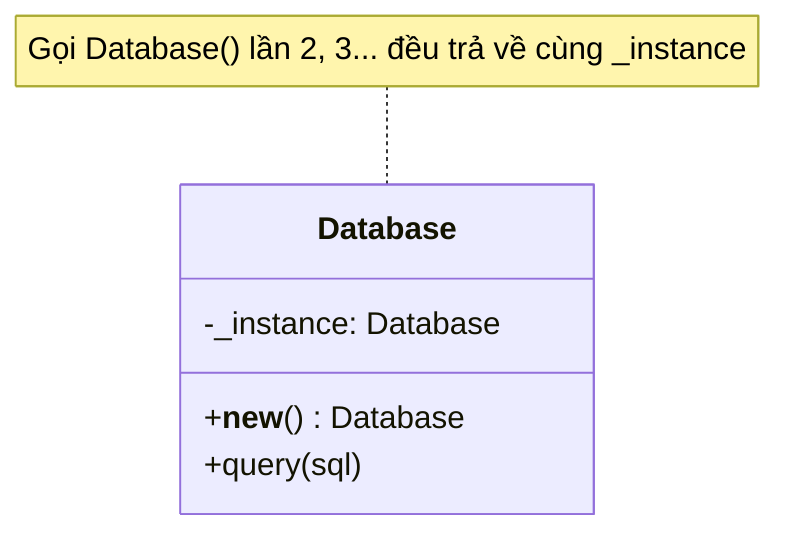

# Singleton

> **Nhóm:** Creational · [← Mục lục](../README.md)

**Một câu:** Đảm bảo một class chỉ có **duy nhất 1 instance**, và cung cấp **một điểm truy cập toàn cục** tới instance đó.

**Ví dụ đời thường:** Mỗi quốc gia chỉ có một chính phủ. Dù bạn hỏi ở đâu, "chính phủ" luôn chỉ về cùng một tổ chức.

---

## 1. Problem

App cần kết nối database. Mở kết nối **tốn thời gian và tài nguyên**, và mọi module nên **dùng chung** một kết nối (hoặc một connection pool).

```python
class Database:
    def __init__(self):
        print("Mở kết nối tới DB...")   # chậm, tốn tài nguyên

# orders.py
db1 = Database()
# users.py
db2 = Database()

print(db1 is db2)   # False → 2 kết nối, 2 trạng thái tách rời nhau
```

Không có gì ngăn người khác gọi `Database()` thêm một lần nữa.

## 2. Solution

1. **Chặn việc tạo mới tùy tiện.** Trong Python, override `__new__`, là hàm thực sự tạo ra object.
2. **Lưu instance vào biến của class.** Lần gọi đầu tiên thì tạo, các lần sau trả về instance đã lưu.



## 3. Code

```python
import threading


class Database:
    _instance: "Database | None" = None
    _lock = threading.Lock()

    def __new__(cls):
        if cls._instance is None:                  # (1) check nhanh, chưa cần khóa
            with cls._lock:                        # (2) mỗi lúc chỉ 1 thread vào được
                if cls._instance is None:          # (3) check lại: thread khác có thể đã tạo xong
                    instance = super().__new__(cls)
                    instance._connect()            # khởi tạo đúng 1 lần
                    cls._instance = instance
        return cls._instance

    # ⚠️ Không khởi tạo trong __init__: Python gọi __init__ MỖI LẦN gọi Database(),
    #    kể cả khi __new__ trả về instance cũ → state sẽ bị reset.
    def _connect(self):
        print("Mở kết nối tới DB...")
        self.queries: list[str] = []

    def query(self, sql: str):
        self.queries.append(sql)
        print(f"Chạy: {sql}")


db1 = Database()          # Mở kết nối tới DB...
db2 = Database()          # (không in gì: dùng lại instance cũ)
db1.query("SELECT 1")     # Chạy: SELECT 1

print(db1 is db2)         # True
print(db2.queries)        # ['SELECT 1'] → dùng chung trạng thái
```

### Pythonic hơn: dùng module

Python chỉ chạy code của một module **1 lần**, dù module đó được import ở bao nhiêu nơi. Vì vậy một biến cấp module đã là singleton:

```python
# database.py
class _Database:
    def __init__(self):
        print("Mở kết nối tới DB...")

db = _Database()          # chỉ được tạo 1 lần, khi module được import lần đầu

# orders.py, users.py, ...
from database import db   # mọi nơi nhận cùng một object
```

Trong Python, **nên ưu tiên cách này**. Chỉ dùng cách `__new__` khi bắt buộc phải gọi được `Database()` hoặc cần lazy init.

## 4. Trade-offs

| ✅ Ưu điểm | ❌ Nhược điểm |
|---|---|
| Chắc chắn chỉ có 1 instance | Thực chất là **biến global trá hình**: tạo phụ thuộc ẩn, khó lần theo |
| Truy cập được từ mọi nơi | **Khó unit test**: state rò từ test này sang test khác, khó mock |
| Lazy init: chỉ tạo khi cần | Vi phạm Single Responsibility: vừa làm logic vừa tự quản lý vòng đời |
| | Phải tự lo thread-safe |

- **Nên dùng khi:** tài nguyên *thật sự* chỉ nên có một, ví dụ config, logger, connection pool, cache.
- **Không nên dùng khi:** lý do duy nhất là "gọi ở đâu cũng được". Khi đó hãy tạo 1 object rồi **truyền nó vào** nơi cần dùng (Dependency Injection): app vẫn chỉ có 1 instance, nhưng test dễ hơn nhiều.

## 5. Ngoài thực tế

- `logging.getLogger("app")`: cùng một tên luôn trả về cùng một logger.
- `None`, `True`, `False` trong Python đều là singleton, nên người ta so sánh bằng `is None`.
- Spring (Java) và NestJS mặc định tạo bean/provider với scope **singleton**, nhưng do DI container quản lý chứ class không tự cài.
- **Dễ nhầm với:** class chỉ có static method. Static class không có instance, không implement interface được và không truyền đi như một object được.

---

[← Mục lục](../README.md) · [Factory Method →](factory-method.md)
