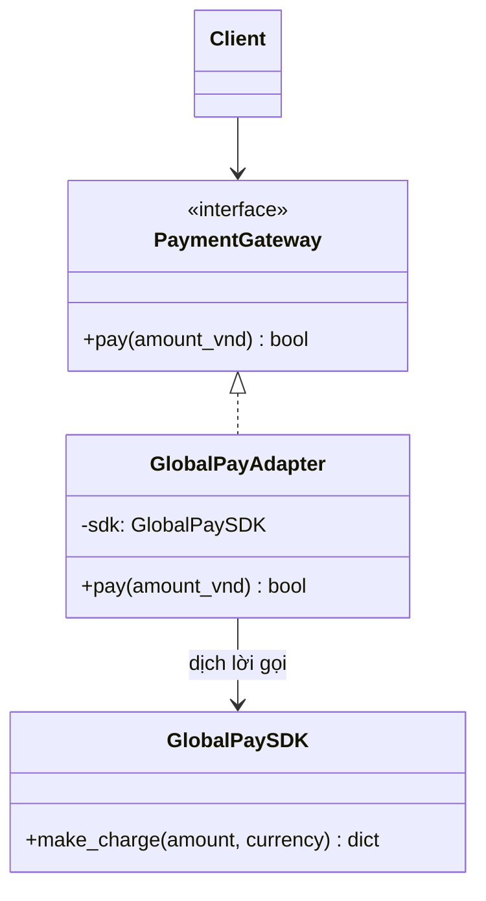

# Adapter

> **Nhóm:** Structural · [← Mục lục](../README.md)

**Một câu:** Tạo một lớp trung gian để **chuyển đổi interface** của một class thành interface mà code của bạn mong đợi.

**Ví dụ đời thường:** Cục chuyển đổi ổ cắm khi đi du lịch giúp phích cắm chân tròn của Việt Nam cắm được vào ổ 3 chấu ở Anh. Phích cắm và ổ cắm đều không phải sửa.

---

## 1. Problem

Toàn bộ app thanh toán qua interface `PaymentGateway.pay(amount_vnd)`. Giờ cần tích hợp SDK của bên thứ 3 là *GlobalPay*, nhưng SDK này có interface hoàn toàn khác:

```python
# Code của bạn: mọi nơi đều gọi theo interface này
def checkout(gateway: PaymentGateway, total: int):
    gateway.pay(total)

# SDK bên thứ 3 (KHÔNG sửa được): khác tên method, khác đơn vị tiền, khác kiểu trả về
class GlobalPaySDK:
    def make_charge(self, amount: float, currency: str) -> dict: ...

checkout(GlobalPaySDK(), 500_000)
# 💥 AttributeError: 'GlobalPaySDK' object has no attribute 'pay'
```

- Sửa `checkout` và mọi chỗ gọi `pay()` thì thay đổi lan ra khắp app.
- Sửa SDK thì không được, vì đó là code bên ngoài và sẽ mất khi cập nhật phiên bản.

## 2. Solution

Tạo class **Adapter**:

1. **Implement interface** mà code của bạn mong đợi (`PaymentGateway`).
2. **Giữ object SDK bên trong** (composition).
3. **Dịch** lời gọi: đổi tên method, đổi đơn vị và kiểu dữ liệu, đổi format kết quả.



## 3. Code

```python
from abc import ABC, abstractmethod


# ----- Target: interface mà code của bạn mong đợi -----
class PaymentGateway(ABC):
    @abstractmethod
    def pay(self, amount_vnd: int) -> bool: ...


class MomoGateway(PaymentGateway):                 # gateway có sẵn, đã đúng interface
    def pay(self, amount_vnd):
        print(f"MoMo: thanh toán {amount_vnd:,}đ")
        return True


# ----- Adaptee: SDK bên thứ 3, KHÔNG được sửa -----
class GlobalPaySDK:
    def make_charge(self, amount: float, currency: str) -> dict:
        print(f"GlobalPay: charge {amount} {currency}")
        return {"status": "succeeded", "id": "ch_123"}


# ----- Adapter: "phiên dịch" giữa hai bên -----
class GlobalPayAdapter(PaymentGateway):
    USD_RATE = 25_000

    def __init__(self, sdk: GlobalPaySDK):
        self._sdk = sdk                                    # giữ adaptee bên trong

    def pay(self, amount_vnd: int) -> bool:
        amount_usd = round(amount_vnd / self.USD_RATE, 2)  # 1. đổi đơn vị
        result = self._sdk.make_charge(amount_usd, "USD")  # 2. đổi tên method
        return result["status"] == "succeeded"             # 3. đổi format kết quả


# ----- Client: chỉ biết PaymentGateway, không biết bên dưới là SDK nào -----
def checkout(gateway: PaymentGateway, total: int):
    if gateway.pay(total):
        print("✅ Đặt hàng thành công")

checkout(MomoGateway(), 500_000)                    # MoMo: thanh toán 500,000đ
checkout(GlobalPayAdapter(GlobalPaySDK()), 500_000)  # GlobalPay: charge 20.0 USD
```

### Pythonic hơn: duck typing

Python không bắt adapter phải kế thừa `PaymentGateway`, chỉ cần có method `pay()` đúng chữ ký là chạy được. Nếu muốn type checker (mypy, pyright) kiểm tra mà vẫn không cần kế thừa, hãy khai báo interface bằng `typing.Protocol` thay cho `ABC`.

## 4. Trade-offs

| ✅ Ưu điểm | ❌ Nhược điểm |
|---|---|
| Tách logic chuyển đổi ra khỏi logic nghiệp vụ (Single Responsibility) | Thêm một lớp trung gian, code có thêm tầng gián tiếp |
| Open/Closed: thêm nhà cung cấp mới chỉ cần thêm adapter mới | Nếu sửa được code gốc thì sửa trực tiếp thường đơn giản hơn |
| Cô lập code bên thứ 3: đổi nhà cung cấp chỉ sửa adapter | |

- **Nên dùng khi:** tích hợp thư viện hoặc API bên ngoài, code legacy, hoặc bất kỳ class nào bạn **không sửa được**.
- **Không nên dùng khi:** bạn sở hữu cả hai bên và sửa được cho chúng khớp nhau.

## 5. Ngoài thực tế

- SQLAlchemy dialect: đưa nhiều database driver (PostgreSQL, MySQL, SQLite) về chung một interface.
- `io.TextIOWrapper`: biến một binary stream thành text stream.
- Hexagonal Architecture, còn gọi là *Ports & Adapters*, lấy luôn tên pattern này.
- **Dễ nhầm với:** **Facade**. Adapter làm cho một interface *có sẵn* dùng được, thường bọc 1 object. Facade tạo một interface *mới, đơn giản hơn* cho cả một hệ thống. Xem thêm bảng so sánh ở [Mục lục](../README.md#các-pattern-dễ-nhầm).

---

[← Builder](../01-creational/builder.md) · [Mục lục](../README.md) · [Decorator →](decorator.md)
