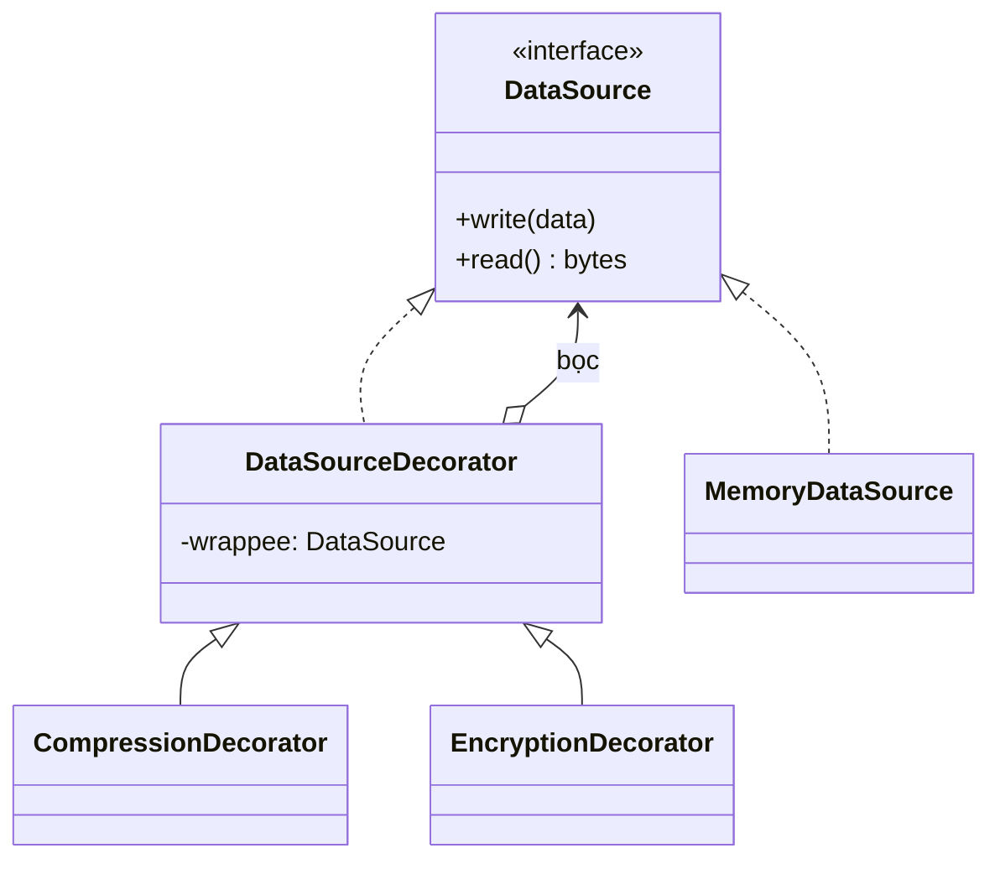

# Decorator

> **Nhóm:** Structural · [← Mục lục](../README.md)

**Một câu:** **Thêm hành vi** cho một object bằng cách **bọc nó** trong một object khác có **cùng interface**. Có thể bọc nhiều lớp chồng lên nhau.

**Ví dụ đời thường:** Mặc áo thun, thêm áo len cho ấm, thêm áo mưa để khỏi ướt. Mỗi lớp áo thêm một "tính năng" và cởi ra lúc nào cũng được, còn người mặc vẫn là người đó.

---

## 1. Problem

Có class `DataSource` để đọc và ghi dữ liệu. Giờ cần thêm **nén**, **mã hóa**, hoặc **cả hai**, tùy trường hợp. Nếu làm bằng kế thừa:

```python
class FileDataSource: ...
class CompressedFileDataSource(FileDataSource): ...
class EncryptedFileDataSource(FileDataSource): ...
class CompressedEncryptedFileDataSource(FileDataSource): ...
# Thêm "Logging" là thêm 4 class nữa. n tính năng → 2ⁿ class 💥
```

- Số subclass **tăng theo cấp số nhân** với số tính năng.
- Kế thừa là **cố định lúc viết code**, không bật tắt được lúc runtime.

## 2. Solution

1. Decorator **implement cùng interface** với object gốc.
2. Decorator **giữ tham chiếu** tới object được bọc (`wrappee`).
3. Mỗi method **chuyển tiếp** lời gọi tới `wrappee` và **thêm hành vi** trước hoặc sau đó.
4. Vì interface giống nhau nên decorator **bọc được decorator khác**, tức là xếp chồng được.



## 3. Code

```python
import base64
import zlib
from abc import ABC, abstractmethod


# ----- Component: interface chung -----
class DataSource(ABC):
    @abstractmethod
    def write(self, data: bytes) -> None: ...

    @abstractmethod
    def read(self) -> bytes: ...


# ----- Concrete Component: object gốc -----
class MemoryDataSource(DataSource):
    def __init__(self):
        self.stored = b""                          # giả lập file, lưu trong RAM

    def write(self, data):
        self.stored = data

    def read(self):
        return self.stored


# ----- Base Decorator: cùng interface + giữ object được bọc -----
class DataSourceDecorator(DataSource):
    def __init__(self, wrappee: DataSource):
        self._wrappee = wrappee

    def write(self, data):
        self._wrappee.write(data)                  # mặc định: chuyển tiếp nguyên vẹn

    def read(self):
        return self._wrappee.read()


# ----- Concrete Decorators: thêm hành vi trước/sau khi chuyển tiếp -----
class CompressionDecorator(DataSourceDecorator):
    def write(self, data):
        super().write(zlib.compress(data))         # nén TRƯỚC khi chuyển xuống

    def read(self):
        return zlib.decompress(super().read())     # giải nén SAU khi đọc lên


class EncryptionDecorator(DataSourceDecorator):
    # Chỉ để minh họa: base64 KHÔNG phải mã hóa. Thực tế hãy dùng cryptography.Fernet
    def write(self, data):
        super().write(base64.b64encode(data))

    def read(self):
        return base64.b64decode(super().read())


# ----- Client: tự lắp ghép lúc runtime -----
storage = MemoryDataSource()
source = CompressionDecorator(EncryptionDecorator(storage))
# Khi write, dữ liệu đi từ ngoài vào trong: nén → mã hóa → lưu

source.write("Bảng lương tháng 10".encode())
print(storage.stored)             # b'eJ...' → đã bị nén và "mã hóa", không đọc được
print(source.read().decode())     # Bảng lương tháng 10

plain = MemoryDataSource()        # cần bản không nén, không mã hóa? Dùng thẳng object gốc
```

> ⚠️ **Thứ tự bọc quan trọng.** Phải nén trước rồi mới mã hóa, vì dữ liệu đã mã hóa gần như không nén được nữa.

### Pythonic hơn: cú pháp `@decorator` cho hàm

Cú pháp `@` của Python áp dụng đúng ý tưởng này ở **cấp hàm**: bọc một hàm, giữ nguyên cách gọi và thêm hành vi.

```python
import functools
import time


def timing(func):
    @functools.wraps(func)                      # giữ tên và docstring của hàm gốc
    def wrapper(*args, **kwargs):
        start = time.perf_counter()
        result = func(*args, **kwargs)          # gọi hàm gốc
        print(f"{func.__name__} mất {time.perf_counter() - start:.3f}s")
        return result
    return wrapper


@timing                                         # tương đương: build_report = timing(build_report)
def build_report():
    time.sleep(0.1)

build_report()                                  # build_report mất 0.100s
```

Các decorator hàm cũng xếp chồng được, ví dụ `@timing` đặt trên `@retry` đặt trên `@cache`.

## 4. Trade-offs

| ✅ Ưu điểm | ❌ Nhược điểm |
|---|---|
| Thêm hoặc bớt hành vi lúc runtime, không sửa class gốc | Kết quả phụ thuộc thứ tự bọc, dễ nhầm |
| Kết hợp tự do nhiều hành vi thay vì 2ⁿ subclass | Khó gỡ một lớp nằm giữa chồng decorator |
| Single Responsibility: mỗi decorator làm 1 việc | Nhiều lớp bọc làm stack trace dài, debug khó hơn |
| | Code khởi tạo trông rối, kiểu `A(B(C(D())))` |

- **Nên dùng khi:** cần các tính năng **tùy chọn, kết hợp linh hoạt** như logging, cache, retry, nén, mã hóa; hoặc khi không kế thừa được (class của thư viện ngoài).
- **Không nên dùng khi:** chỉ có một biến thể cố định. Khi đó sửa thẳng class cho đơn giản.

## 5. Ngoài thực tế

- Module `io` của Python: `io.BufferedReader(io.FileIO("a.txt"))` và `gzip.GzipFile(fileobj=f)`.
- Decorator hàm: `@functools.lru_cache`, `@retry` của thư viện tenacity, `@login_required` của Django.
- Java I/O: `new BufferedReader(new InputStreamReader(stream))`.
- **Dễ nhầm với:** **Proxy**. Cả hai đều giữ nguyên interface, nhưng Decorator do *client tự lắp* và xếp chồng được để *thêm tính năng*. Proxy thường *tự quản lý* object thật và dùng để *kiểm soát truy cập*.

---

[← Adapter](adapter.md) · [Mục lục](../README.md) · [Facade →](facade.md)
