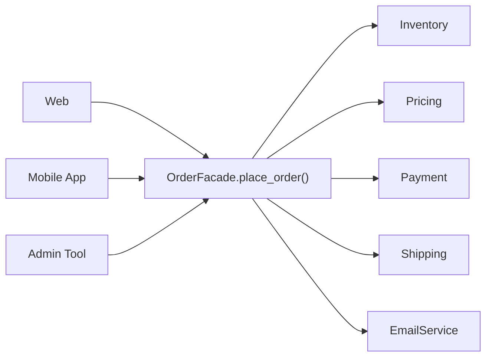

# Facade

> **Nhóm:** Structural · [← Mục lục](../README.md)

**Một câu:** Cung cấp **một interface đơn giản** cho một hệ thống gồm nhiều thành phần phức tạp.

**Ví dụ đời thường:** Bạn gọi lễ tân khách sạn: "Đặt giúp tôi taxi ra sân bay lúc 6 giờ sáng." Lễ tân tự liên hệ hãng taxi, báo bếp chuẩn bị đồ ăn sáng mang đi và hẹn giờ gọi báo thức. Bạn không cần biết các bên đó là ai.

---

## 1. Problem

Đặt một đơn hàng cần gọi 5 subsystem theo **đúng thứ tự**:

```python
# Web controller, mobile API, admin tool... đều phải lặp lại đoạn này:
if inventory.check(sku, qty):
    amount = pricing.calculate(sku, qty, coupon)
    if payment.charge(user_id, amount):
        inventory.reserve(sku, qty)
        tracking = shipping.create_shipment(user_id, sku)
        email.send(user_id, f"Mã vận đơn: {tracking}")
```

- Client **phụ thuộc vào cả 5 subsystem** và phải biết đúng thứ tự gọi.
- Cùng một đoạn code bị **lặp lại** ở nhiều nơi. Đổi quy trình, ví dụ thêm bước tích điểm, là phải sửa tất cả.
- Dễ sai thứ tự, ví dụ trừ kho trước khi thanh toán thành công.

## 2. Solution

Tạo class **Facade** với một method đơn giản là `place_order()`. Bên trong, Facade điều phối các subsystem.

- Subsystem **không biết** Facade tồn tại.
- Khi cần tính năng nâng cao, client **vẫn có thể** gọi thẳng subsystem.



## 3. Code

```python
# ----- Subsystems: các module phức tạp (ở đây đã rút gọn) -----
class Inventory:
    def __init__(self):
        self.stock = {"IPHONE15": 5}

    def check(self, sku, qty):
        return self.stock.get(sku, 0) >= qty

    def reserve(self, sku, qty):
        self.stock[sku] -= qty


class Pricing:
    PRICES = {"IPHONE15": 20_000_000}

    def calculate(self, sku, qty, coupon=None):
        total = self.PRICES[sku] * qty
        return total * 0.9 if coupon == "SALE10" else total


class Payment:
    def charge(self, user_id, amount):
        print(f"💳 Trừ {amount:,.0f}đ của user {user_id}")
        return True


class Shipping:
    def create_shipment(self, user_id, sku):
        return f"VD-{user_id}-{sku}"


class EmailService:
    def send(self, user_id, message):
        print(f"📧 Gửi user {user_id}: {message}")


# ----- Facade: một cửa duy nhất, ẩn toàn bộ quy trình -----
class OrderFacade:
    def __init__(self):
        self.inventory = Inventory()
        self.pricing = Pricing()
        self.payment = Payment()
        self.shipping = Shipping()
        self.email = EmailService()

    def place_order(self, user_id: int, sku: str, qty: int, coupon: str | None = None) -> str:
        if not self.inventory.check(sku, qty):
            raise ValueError("Hết hàng")
        amount = self.pricing.calculate(sku, qty, coupon)
        if not self.payment.charge(user_id, amount):
            raise RuntimeError("Thanh toán thất bại")
        self.inventory.reserve(sku, qty)               # chỉ trừ kho SAU khi thanh toán OK
        tracking = self.shipping.create_shipment(user_id, sku)
        self.email.send(user_id, f"Đặt hàng thành công. Mã vận đơn: {tracking}")
        return tracking


# ----- Client: chỉ cần 1 dòng -----
shop = OrderFacade()
shop.place_order(user_id=42, sku="IPHONE15", qty=1, coupon="SALE10")
# 💳 Trừ 18,000,000đ của user 42
# 📧 Gửi user 42: Đặt hàng thành công. Mã vận đơn: VD-42-IPHONE15
```

> 💡 Trong dự án thật, hãy **truyền** các subsystem vào `__init__` (Dependency Injection) thay vì tự tạo trong đó, để khi test có thể thay bằng mock.

### Pythonic hơn

Facade không nhất thiết phải là class. Một **hàm** hoặc file `__init__.py` của package export ra vài hàm gọn gàng cũng là Facade.

## 4. Trade-offs

| ✅ Ưu điểm | ❌ Nhược điểm |
|---|---|
| Client đơn giản, ít phụ thuộc vào subsystem | Dễ phình thành **God Object** nếu nhồi mọi thứ vào. Khi đó hãy tách thành nhiều facade nhỏ |
| Đổi bên trong không ảnh hưởng tới client | Che giấu chi tiết, nên nhu cầu đặc biệt vẫn phải gọi thẳng subsystem |
| Quy trình nằm ở 1 chỗ: không lặp code, không sai thứ tự | |

- **Nên dùng khi:** hệ thống hoặc thư viện phức tạp mà client chỉ dùng một phần; khi chia layer (service layer chính là facade cho domain và repository).
- **Không nên dùng khi:** subsystem vốn đã đơn giản. Thêm facade chỉ tạo thêm một lớp thừa.

## 5. Ngoài thực tế

- `requests.get(url)`: ẩn `Session`, `PreparedRequest`, `HTTPAdapter` và connection pool của urllib3.
- `subprocess.run()`: facade gọn gàng bọc ngoài `subprocess.Popen`.
- Service layer trong kiến trúc nhiều tầng, ví dụ class `OrderService`.
- **Dễ nhầm với:** **Adapter**. Adapter làm cho một interface *có sẵn* dùng được; Facade tạo một interface *mới, đơn giản hơn*. Cũng dễ nhầm với **Mediator**: ở Mediator các thành phần *biết* mediator và giao tiếp qua nó, còn ở Facade các subsystem *không biết* facade tồn tại.

---

[← Decorator](decorator.md) · [Mục lục](../README.md) · [Proxy →](proxy.md)
