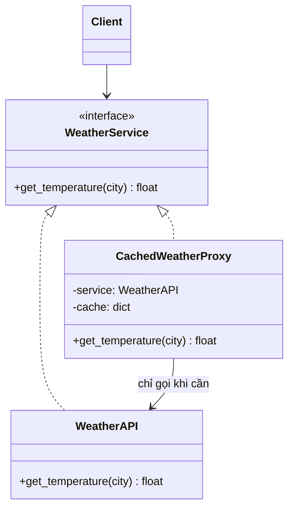

# Proxy

> **Nhóm:** Structural · [← Mục lục](../README.md)

**Một câu:** Tạo một object **đứng thay** cho object thật, có **cùng interface**, để **kiểm soát việc truy cập** vào object thật: cache, khởi tạo trễ, kiểm tra quyền, ghi log...

**Ví dụ đời thường:** Thư ký của giám đốc. Bạn nói chuyện với thư ký như nói với giám đốc. Thư ký tự trả lời những câu đã biết (cache), chặn người không có lịch hẹn (kiểm tra quyền), và chỉ chuyển lên giám đốc khi thật sự cần.

---

## 1. Problem

`WeatherAPI` gọi một dịch vụ bên ngoài **chậm** (1 giây mỗi lần) và **tính phí theo lượt gọi**. Nhiều nơi trong app hỏi cùng một thành phố liên tục:

```python
api = WeatherAPI()
api.get_temperature("Hanoi")   # ⏳ 1s, tốn 1 lượt
api.get_temperature("Hanoi")   # ⏳ lại 1s, lại tốn tiền, dù kết quả y hệt
```

- Thêm cache vào **từng chỗ gọi** thì code bị lặp lại.
- Sửa `WeatherAPI` thì có thể không được, vì đó là thư viện, hoặc làm class ôm thêm trách nhiệm không phải của nó.

## 2. Solution

1. Proxy **implement cùng interface** với service thật, nên client dùng proxy y như dùng service thật.
2. Proxy **giữ** (và thường **tự tạo**) service thật.
3. Trước khi chuyển tiếp lời gọi, proxy **quyết định**: trả ngay kết quả cache, từ chối, hay gọi service thật.



## 3. Code

```python
import time
from abc import ABC, abstractmethod


# ----- Subject: interface chung -----
class WeatherService(ABC):
    @abstractmethod
    def get_temperature(self, city: str) -> float: ...


# ----- Real Subject: service thật, chậm và tốn tiền -----
class WeatherAPI(WeatherService):
    def get_temperature(self, city):
        print(f"🌐 Gọi API cho {city}...")
        time.sleep(1)                                      # giả lập mạng chậm
        return {"Hanoi": 24.5, "HCM": 32.0}.get(city, 28.0)


# ----- Proxy: cùng interface, kiểm soát truy cập vào service thật -----
class CachedWeatherProxy(WeatherService):
    def __init__(self, ttl_seconds: int = 600):
        self._service: WeatherAPI | None = None            # chưa tạo service thật
        self._cache: dict[str, tuple[float, float]] = {}   # city -> (nhiệt độ, thời điểm lưu)
        self._ttl = ttl_seconds

    def get_temperature(self, city):
        if city in self._cache:
            temp, saved_at = self._cache[city]
            if time.time() - saved_at < self._ttl:
                print(f"⚡ Cache hit: {city}")
                return temp                                # không chạm tới service thật

        if self._service is None:
            self._service = WeatherAPI()                   # lazy init: chỉ tạo khi thật sự cần
        temp = self._service.get_temperature(city)
        self._cache[city] = (temp, time.time())
        return temp


# ----- Client: không biết mình đang dùng proxy -----
def show_weather(service: WeatherService, city: str):
    print(f"{city}: {service.get_temperature(city)}°C")

weather = CachedWeatherProxy()
show_weather(weather, "Hanoi")   # 🌐 Gọi API cho Hanoi... (mất 1s)
show_weather(weather, "Hanoi")   # ⚡ Cache hit: Hanoi (trả ngay)
show_weather(weather, "HCM")     # 🌐 Gọi API cho HCM...
```

### Các loại Proxy thường gặp

| Loại | Làm gì | Ví dụ |
|---|---|---|
| **Caching** | Lưu kết quả để dùng lại | Ví dụ ở trên |
| **Virtual** (lazy) | Hoãn tạo object nặng tới khi thật sự dùng | Ảnh lớn, kết nối DB |
| **Protection** | Kiểm tra quyền trước khi cho gọi | Chỉ admin được gọi `delete_user()` |
| **Remote** | Object nằm ở máy khác nhưng gọi như object local | gRPC stub, RPC client |
| **Logging** | Ghi log mọi lời gọi | Audit log |

### Pythonic hơn: proxy tổng quát với `__getattr__`

```python
class LoggingProxy:
    def __init__(self, target):
        self._target = target

    def __getattr__(self, name):              # Python gọi hàm này khi proxy không có thuộc tính `name`
        print(f"→ truy cập {name}")
        return getattr(self._target, name)    # chuyển tiếp MỌI thứ tới object thật

api = LoggingProxy(WeatherAPI())
api.get_temperature("HCM")                    # → truy cập get_temperature, sau đó gọi API thật
```

Với cache ở cấp hàm, chỉ cần dùng `@functools.lru_cache` hoặc `@functools.cache`.

## 4. Trade-offs

| ✅ Ưu điểm | ❌ Nhược điểm |
|---|---|
| Kiểm soát service mà client không hề hay biết | Thêm một tầng, có thể tăng độ trễ |
| Open/Closed: thêm proxy mới không phải sửa service hay client | Cache có thể trả dữ liệu cũ, phải chọn TTL và cách làm mới cache |
| Quản lý vòng đời service: lazy init, giải phóng tài nguyên | Thêm class, code phức tạp hơn |

- **Nên dùng khi:** object nặng cần lazy load; cần cache, kiểm tra quyền hoặc ghi log mà không sửa service.
- **Không nên dùng khi:** logic kiểm soát đơn giản và chỉ dùng ở 1 chỗ.

## 5. Ngoài thực tế

- ORM lazy loading: với Django hay SQLAlchemy, `user.orders` chỉ thực sự query DB khi được truy cập.
- Django: `request.user` là một `SimpleLazyObject`, một virtual proxy.
- `unittest.mock.Mock` là object giả đứng thay cho object thật khi test.
- Nginx reverse proxy áp dụng cùng ý tưởng nhưng ở tầng hạ tầng.
- **Dễ nhầm với:** **Decorator**. Xem bảng so sánh ở [Mục lục](../README.md#các-pattern-dễ-nhầm).

---

[← Facade](facade.md) · [Mục lục](../README.md) · [Strategy →](../03-behavioral/strategy.md)
