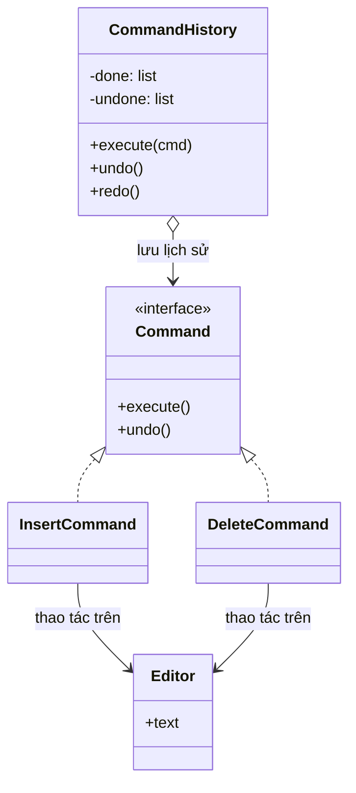

# Command

> **Nhóm:** Behavioral · [← Mục lục](../README.md)

**Một câu:** **Đóng gói một yêu cầu thành object** chứa đủ thông tin để thực hiện nó. Nhờ vậy yêu cầu có thể được lưu lại, xếp hàng, chạy sau hoặc **hoàn tác (undo)**.

**Ví dụ đời thường:** Gọi món ở nhà hàng. Người phục vụ ghi order ra giấy (command), tờ giấy được xếp vào hàng chờ của bếp, rồi đầu bếp làm theo. Người phục vụ không cần biết nấu, và order có thể xếp hàng hoặc bị hủy.

---

## 1. Problem

Một text editor có nút **Paste**, phím **Ctrl+V** và menu **Edit → Paste**. Cả ba đều làm cùng một việc, và người dùng cần **Ctrl+Z** để hoàn tác.

```python
def on_paste_button():
    editor.text += clipboard       # logic nằm trong UI handler

def on_ctrl_v():
    editor.text += clipboard       # copy y hệt

def on_menu_paste():
    editor.text += clipboard       # lại copy

# Ctrl+Z? Không có gì để hoàn tác, vì thao tác chạy xong là "biến mất",
# không ai nhớ đã làm gì hay trạng thái trước đó ra sao.
```

- Logic bị **lặp lại** ở mọi nơi kích hoạt hành động.
- UI bị **gắn chặt** với logic xử lý.
- **Không có lịch sử**, nên không làm được undo/redo.

## 2. Solution

1. Mỗi thao tác là **một class Command** có `execute()` và `undo()`.
2. Command **lưu đủ thông tin**: object nhận lệnh (*receiver*), tham số, và dữ liệu backup để hoàn tác.
3. Nơi ra lệnh (*invoker*: nút bấm, phím tắt) chỉ cần gọi `execute()`, không cần biết bên trong làm gì.
4. Một **history** lưu các command đã chạy. Undo nghĩa là lấy command cuối ra và gọi `undo()`.



## 3. Code

```python
from abc import ABC, abstractmethod


# ----- Receiver: object thực sự bị thay đổi -----
class Editor:
    def __init__(self):
        self.text = ""


# ----- Command interface -----
class Command(ABC):
    @abstractmethod
    def execute(self) -> None: ...

    @abstractmethod
    def undo(self) -> None: ...


# ----- Concrete Commands: lưu đủ thông tin để làm VÀ hoàn tác -----
class InsertCommand(Command):
    def __init__(self, editor: Editor, text: str):
        self.editor = editor
        self.text = text

    def execute(self):
        self.editor.text += self.text

    def undo(self):
        self.editor.text = self.editor.text[: -len(self.text)]


class DeleteCommand(Command):
    def __init__(self, editor: Editor, count: int):
        self.editor = editor
        self.count = count
        self.deleted = ""                          # backup để undo

    def execute(self):
        self.deleted = self.editor.text[-self.count :]
        self.editor.text = self.editor.text[: -self.count]

    def undo(self):
        self.editor.text += self.deleted


# ----- Invoker: chạy command và nhớ lịch sử, không biết command làm gì -----
class CommandHistory:
    def __init__(self):
        self._done: list[Command] = []
        self._undone: list[Command] = []

    def execute(self, cmd: Command):
        cmd.execute()
        self._done.append(cmd)
        self._undone.clear()                       # có thao tác mới → xóa lịch sử redo

    def undo(self):
        if self._done:
            cmd = self._done.pop()
            cmd.undo()
            self._undone.append(cmd)

    def redo(self):
        if self._undone:
            cmd = self._undone.pop()
            cmd.execute()
            self._done.append(cmd)


# ----- Client -----
editor = Editor()
history = CommandHistory()

# Nút Paste, Ctrl+V hay menu đều chỉ cần gọi đúng 1 dòng như thế này
history.execute(InsertCommand(editor, "Xin chào"))
history.execute(InsertCommand(editor, " thế giới"))
history.execute(DeleteCommand(editor, 5))
print(editor.text)    # Xin chào thế

history.undo()        # hoàn tác lệnh xóa
print(editor.text)    # Xin chào thế giới

history.undo()        # hoàn tác lệnh chèn thứ 2
print(editor.text)    # Xin chào

history.redo()
print(editor.text)    # Xin chào thế giới
```

### Pythonic hơn: không cần undo thì dùng hàm

Nếu chỉ cần **xếp hàng hoặc chạy sau** mà không cần undo, `functools.partial` hoặc closure là đủ để đóng gói "việc cần làm":

```python
from functools import partial

def send_email(to: str, subject: str):
    print(f"📧 {to}: {subject}")

jobs = [                                   # hàng đợi các "command"
    partial(send_email, "an@example.com", "Chào mừng"),
    partial(send_email, "binh@example.com", "Hóa đơn tháng 10"),
]
for job in jobs:
    job()                                  # chạy khi nào tùy bạn
```

## 4. Trade-offs

| ✅ Ưu điểm | ❌ Nhược điểm |
|---|---|
| Làm được undo/redo | Mỗi thao tác cần 1 class, số class tăng nhanh |
| Tách nơi *ra lệnh* (UI) khỏi nơi *thực hiện* (Editor) | Undo khó khi thao tác có side effect bên ngoài: email đã gửi thì không "thu hồi" được, phải có hành động bù trừ |
| Xếp hàng đợi, lên lịch, retry, ghi log để chạy lại (replay) | Lưu dữ liệu backup để undo tốn bộ nhớ |
| Gộp nhiều command thành một *macro* | |
| Open/Closed: thêm command mới không phải sửa invoker | |

- **Nên dùng khi:** cần undo/redo; cần đưa thao tác vào hàng đợi, lên lịch hoặc retry; cần ghi log thao tác để audit hoặc replay.
- **Không nên dùng khi:** thao tác đơn giản, gọi thẳng là xong, không cần lịch sử hay hàng đợi.

## 5. Ngoài thực tế

- Ctrl+Z / Ctrl+Y trong mọi editor.
- Task của Celery/RQ: command được serialize rồi đưa vào queue cho worker chạy sau.
- Migration của Alembic/Django: `upgrade()` / `downgrade()` chính là `execute()` / `undo()`.
- Chữ *Command* trong CQRS cũng mang đúng ý nghĩa này.
- **Dễ nhầm với:** **Strategy** (xem ở [Mục lục](../README.md#các-pattern-dễ-nhầm)). Command cũng hay đi cùng **Memento**: Memento lưu *snapshot trạng thái* để undo, còn ở đây mỗi command tự lưu phần dữ liệu cần để hoàn tác.

---

[← Observer](observer.md) · [Mục lục](../README.md)
