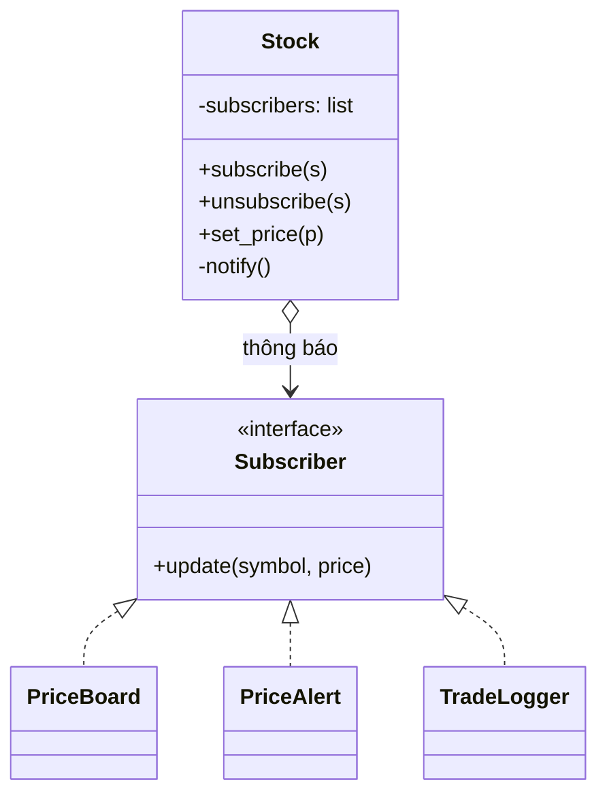

# Observer

> **Nhóm:** Behavioral · [← Mục lục](../README.md)

**Một câu:** Cho phép nhiều object **đăng ký theo dõi** một object khác, và **tự động được thông báo** mỗi khi object đó thay đổi.

**Ví dụ đời thường:** Đăng ký một kênh YouTube. Khi có video mới, kênh tự báo cho bạn; bạn không phải ngày nào cũng vào kiểm tra. Hủy đăng ký lúc nào cũng được.

---

## 1. Problem

Khi giá cổ phiếu thay đổi, cần cập nhật bảng giá, gửi cảnh báo nếu giá chạm ngưỡng và ghi log. Cách làm thô:

```python
class Stock:
    def set_price(self, price):
        self.price = price
        price_board.update(self.symbol, price)    # Stock phải biết MỌI module
        alert_service.check(self.symbol, price)
        trade_logger.log(self.symbol, price)
        # Thêm module "AI dự đoán" → lại phải sửa Stock 😩
```

- `Stock` bị **gắn chặt** với mọi module cần nhận tin.
- Cách ngược lại là để các module liên tục hỏi "giá đổi chưa?" (*polling*), vừa lãng phí vừa bị trễ.

## 2. Solution

1. **Publisher** (`Stock`) giữ một **danh sách subscriber**, có `subscribe()` và `unsubscribe()`.
2. Mọi subscriber implement **chung một interface** (`update()`).
3. Khi có thay đổi, publisher **duyệt danh sách** và gọi `update()` của từng subscriber. Publisher không cần biết subscriber là class gì.



## 3. Code

```python
from abc import ABC, abstractmethod


# ----- Subscriber interface -----
class Subscriber(ABC):
    @abstractmethod
    def update(self, symbol: str, price: float) -> None: ...


# ----- Publisher -----
class Stock:
    def __init__(self, symbol: str, price: float):
        self.symbol = symbol
        self._price = price
        self._subscribers: list[Subscriber] = []

    def subscribe(self, sub: Subscriber):
        self._subscribers.append(sub)

    def unsubscribe(self, sub: Subscriber):
        self._subscribers.remove(sub)

    def set_price(self, price: float):
        self._price = price
        self._notify()                         # giá đổi → tự động báo tin

    def _notify(self):
        for sub in self._subscribers:          # không biết sub là class gì, chỉ biết có update()
            sub.update(self.symbol, self._price)


# ----- Concrete Subscribers: mỗi module tự quyết định cách phản ứng -----
class PriceBoard(Subscriber):
    def update(self, symbol, price):
        print(f"📊 Bảng giá: {symbol} = {price:,.0f}")


class PriceAlert(Subscriber):
    def __init__(self, threshold: float):
        self.threshold = threshold

    def update(self, symbol, price):
        if price >= self.threshold:
            print(f"🔔 Cảnh báo: {symbol} chạm {price:,.0f} (ngưỡng {self.threshold:,.0f})")


class TradeLogger(Subscriber):
    def update(self, symbol, price):
        print(f"📝 Log: {symbol} → {price:,.0f}")


# ----- Client: lắp ráp lúc runtime -----
fpt = Stock("FPT", 120_000)
board, alert, logger = PriceBoard(), PriceAlert(threshold=125_000), TradeLogger()
fpt.subscribe(board)
fpt.subscribe(alert)
fpt.subscribe(logger)

fpt.set_price(123_000)
# 📊 Bảng giá: FPT = 123,000
# 📝 Log: FPT → 123,000

fpt.unsubscribe(logger)                # tắt log, không ảnh hưởng tới ai khác
fpt.set_price(126_000)
# 📊 Bảng giá: FPT = 126,000
# 🔔 Cảnh báo: FPT chạm 126,000 (ngưỡng 125,000)
```

**Muốn thêm module "AI dự đoán"?** Viết class mới implement `Subscriber` rồi `subscribe()`. Không phải sửa `Stock`.

### Pythonic hơn: Event Bus với callable

Subscriber có thể chỉ là một **hàm**, lambda hoặc bound method. Thêm **tên sự kiện** vào nữa là có một event bus đơn giản:

```python
from collections import defaultdict
from typing import Callable


class EventBus:
    def __init__(self):
        self._handlers: dict[str, list[Callable]] = defaultdict(list)

    def on(self, event: str, handler: Callable):
        self._handlers[event].append(handler)

    def emit(self, event: str, **data):
        for handler in self._handlers[event]:
            handler(**data)


bus = EventBus()
bus.on("price_changed", lambda symbol, price: print(f"{symbol}: {price:,}"))
bus.emit("price_changed", symbol="VNM", price=68_000)   # VNM: 68,000
```

## 4. Trade-offs

| ✅ Ưu điểm | ❌ Nhược điểm |
|---|---|
| Open/Closed: thêm subscriber mới không sửa publisher | Thứ tự thông báo không được đảm bảo, đừng viết code phụ thuộc vào nó |
| Loose coupling: publisher chỉ biết interface | Khó debug khi nhiều tầng: ai đang nghe, ai gây ra hiệu ứng này? |
| Đăng ký và hủy đăng ký lúc runtime | Quên `unsubscribe` thì publisher vẫn giữ reference, gây **memory leak** |
| | Gọi đồng bộ: một subscriber lỗi hoặc chậm sẽ chặn các subscriber sau, cần try/except hoặc queue |

- **Nên dùng khi:** thay đổi của một object cần cập nhật nhiều object khác mà không biết trước số lượng; hệ thống event-driven; UI.
- **Không nên dùng khi:** chỉ có đúng 1 bên nhận cố định. Gọi thẳng sẽ rõ ràng hơn.

## 5. Ngoài thực tế

- Django signals: `post_save`, `pre_delete`...
- Sự kiện GUI: `addEventListener` trong JS, `bind` trong Tkinter.
- RxJS / ReactiveX, state management trong frontend (Redux `subscribe`, Vue reactivity).
- WebSocket đẩy giá chứng khoán realtime tới client.
- **Dễ nhầm với:** **Pub/Sub qua message broker** như Kafka hay RabbitMQ. Ở Observer, publisher *giữ trực tiếp* danh sách subscriber. Ở Pub/Sub, hai bên *không biết nhau* mà giao tiếp qua broker ở giữa, nhờ vậy chạy được trên nhiều service khác nhau.

---

[← Strategy](strategy.md) · [Mục lục](../README.md) · [Command →](command.md)
