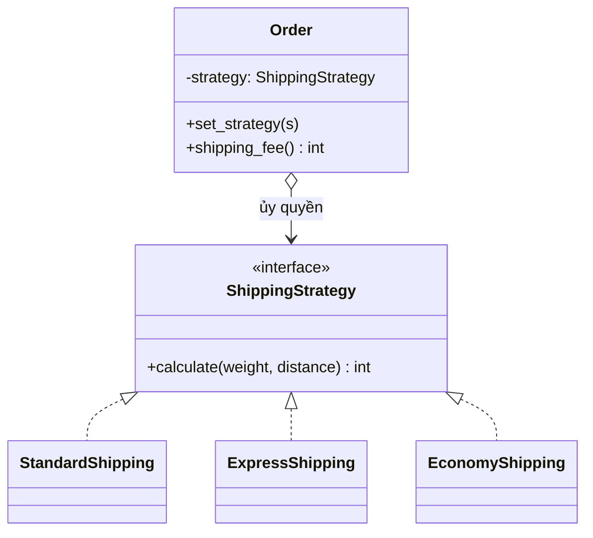

# Strategy

> **Nhóm:** Behavioral · [← Mục lục](../README.md)

**Một câu:** Đưa mỗi thuật toán vào **một class riêng** có **chung interface**, để có thể **hoán đổi** thuật toán lúc runtime.

**Ví dụ đời thường:** Đi từ nhà ra sân bay, bạn có thể đi xe máy, taxi hoặc xe buýt. Mục đích như nhau, chỉ khác cách đi, và bạn chọn theo thời gian hoặc ngân sách.

---

## 1. Problem

Tính phí vận chuyển theo nhiều phương thức:

```python
class ShippingCalculator:
    def calculate(self, method: str, weight_kg: float, distance_km: float) -> int:
        if method == "standard":
            return 15_000 + 2_000 * weight_kg
        elif method == "express":
            return 30_000 + 5_000 * weight_kg + 500 * distance_km
        elif method == "economy":
            return 10_000 + 1_000 * weight_kg if distance_km < 500 else 25_000
        # Thêm "same_day", "international"... hàm cứ phình to mãi
```

- Mỗi lần thêm hoặc sửa một phương thức đều phải **sửa cùng một hàm**, dễ làm hỏng các phương thức khác.
- Không test riêng được từng thuật toán.
- Khối if/elif này thường còn bị **copy** sang nơi khác, ví dụ trang ước tính phí.

## 2. Solution

1. Định nghĩa **interface chung** cho mọi thuật toán (`ShippingStrategy`).
2. Mỗi thuật toán là **một class riêng** (*concrete strategy*).
3. Class chính (*context*, ở đây là `Order`) **giữ một strategy** và **giao việc** cho nó, không tự tính.
4. **Client chọn** strategy nào để đưa vào context.



## 3. Code

```python
from abc import ABC, abstractmethod


# ----- Strategy: interface chung cho mọi thuật toán -----
class ShippingStrategy(ABC):
    @abstractmethod
    def calculate(self, weight_kg: float, distance_km: float) -> int: ...


# ----- Concrete Strategies: mỗi thuật toán 1 class, độc lập với nhau -----
class StandardShipping(ShippingStrategy):
    def calculate(self, weight_kg, distance_km):
        return int(15_000 + 2_000 * weight_kg)


class ExpressShipping(ShippingStrategy):
    def calculate(self, weight_kg, distance_km):
        return int(30_000 + 5_000 * weight_kg + 500 * distance_km)


class EconomyShipping(ShippingStrategy):
    def calculate(self, weight_kg, distance_km):
        return int(10_000 + 1_000 * weight_kg) if distance_km < 500 else 25_000


# ----- Context: dùng strategy, không cần biết bên trong tính thế nào -----
class Order:
    def __init__(self, weight_kg: float, distance_km: float, strategy: ShippingStrategy):
        self.weight_kg = weight_kg
        self.distance_km = distance_km
        self._strategy = strategy

    def set_strategy(self, strategy: ShippingStrategy):
        self._strategy = strategy                     # đổi thuật toán lúc runtime

    def shipping_fee(self) -> int:
        return self._strategy.calculate(self.weight_kg, self.distance_km)  # giao việc


# ----- Client: chọn strategy -----
order = Order(weight_kg=2, distance_km=30, strategy=StandardShipping())
print(order.shipping_fee())             # 19000

order.set_strategy(ExpressShipping())   # khách đổi sang giao nhanh
print(order.shipping_fee())             # 55000
```

**Muốn thêm "giao trong ngày"?** Chỉ cần viết class `SameDayShipping`, không động vào `Order` hay các strategy khác.

### Pythonic hơn: strategy là một hàm

Trong Python, hàm là first-class object nên strategy có thể chỉ là một **hàm**:

```python
from typing import Callable

ShippingFn = Callable[[float, float], int]


def standard(weight_kg: float, distance_km: float) -> int:
    return int(15_000 + 2_000 * weight_kg)


def express(weight_kg: float, distance_km: float) -> int:
    return int(30_000 + 5_000 * weight_kg + 500 * distance_km)


STRATEGIES: dict[str, ShippingFn] = {"standard": standard, "express": express}

fee = STRATEGIES["express"](2, 30)     # chọn theo input của user hoặc config → 55000
```

- Dùng **hàm** khi strategy không có state và chỉ có 1 method.
- Dùng **class** khi strategy cần config hoặc state riêng (ví dụ `ExpressShipping(surcharge=10_000)`), hoặc có nhiều method.
- Tham số `key=` trong `sorted(items, key=...)` chính là một strategy.

## 4. Trade-offs

| ✅ Ưu điểm | ❌ Nhược điểm |
|---|---|
| Đổi thuật toán lúc runtime | Client phải hiểu các strategy khác nhau thế nào để chọn đúng |
| Bỏ được chuỗi if/elif dài | Thêm nhiều class nhỏ, quá mức nếu chỉ có 2–3 nhánh ít đổi |
| Open/Closed: thêm thuật toán = thêm class | Trong Python, nhiều khi một hàm là đủ |
| Test từng thuật toán riêng biệt | |

- **Nên dùng khi:** có nhiều biến thể của cùng một thuật toán, ví dụ tính phí, giảm giá, sắp xếp, xác thực; hoặc khi khối if/elif chọn thuật toán lớn dần và hay thay đổi.
- **Không nên dùng khi:** chỉ có 2–3 nhánh và gần như không bao giờ đổi.

## 5. Ngoài thực tế

- `sorted(key=...)`, `max(key=...)`, `json.dumps(default=...)`.
- Django `AUTHENTICATION_BACKENDS`: mỗi backend là một strategy xác thực.
- Passport.js (Node): đặt luôn tên là *strategies* (`passport-local`, `passport-google`...).
- **Dễ nhầm với:** **State**. Cấu trúc gần như giống hệt, nhưng ở State các state *biết nhau* và tự chuyển qua lại; còn strategy *độc lập* và do client chọn. Còn khác biệt giữa Strategy và Command thì xem ở [Mục lục](../README.md#các-pattern-dễ-nhầm).

---

[← Proxy](../02-structural/proxy.md) · [Mục lục](../README.md) · [Observer →](observer.md)
