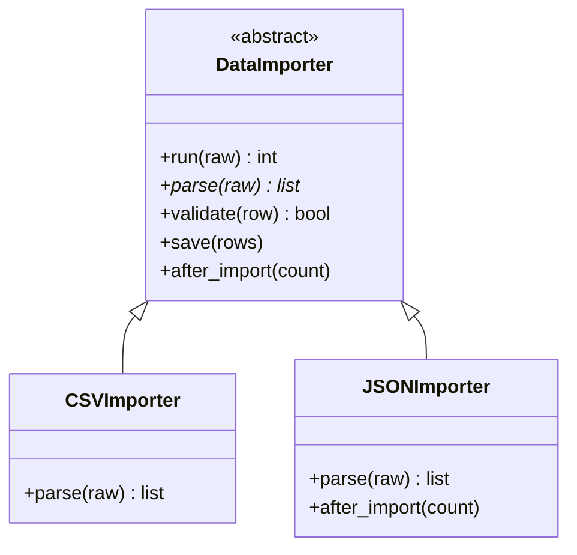

# Template Method

> **Nhóm:** Behavioral · [← Mục lục](../README.md)

**Purpose:** Định nghĩa **bộ khung (skeleton)** của một thuật toán ở class cha, cho phép subclass override từng bước cụ thể mà không thay đổi cấu trúc của thuật toán.

**Analogy:** Xây nhà theo một bản thiết kế mẫu: đổ móng → dựng khung → lợp mái → hoàn thiện. Thứ tự này cố định. Mỗi chủ nhà chỉ chọn khác ở vài bước, ví dụ mái ngói hay mái tôn, sơn màu gì.

---

## 1. Problem

Import danh sách khách hàng từ nhiều định dạng file:

```python
class CSVImporter:
    def run(self, raw: str) -> int:
        rows = list(csv.DictReader(io.StringIO(raw)))
        valid = [r for r in rows if r.get("email") and "@" in r["email"]]
        print(f"💾 Lưu {len(valid)} dòng vào DB")
        return len(valid)


class JSONImporter:
    def run(self, raw: str) -> int:
        rows = json.loads(raw)
        valid = [r for r in rows if r.get("email")]      # quên kiểm tra "@", hai bản đã lệch nhau
        print(f"💾 Lưu {len(valid)} dòng vào DB")
        print(f"📣 Báo Slack: đã import {len(valid)} khách hàng")
        return len(valid)
```

- Hai class giống nhau **gần như toàn bộ**, chỉ khác ở bước đọc file.
- Sửa logic validate hoặc save phải sửa **ở mọi class**, sót một chỗ là dữ liệu bẩn lọt vào DB.
- Không có gì bảo đảm các class chạy **đúng thứ tự** parse → validate → save.

## 2. Solution

1. Class cha (_abstract class_) có một **template method** (`run`) gọi các bước **theo thứ tự cố định**.
2. Bước nào mỗi định dạng làm khác nhau thì để **abstract**, class con bắt buộc viết (`parse`).
3. Bước nào dùng chung thì viết sẵn ở class cha, class con **có thể override** nếu cần (`validate`, `save`).
4. **Hook** là bước mặc định không làm gì, class con override khi muốn chen thêm việc (`after_import`).

Class cha gọi các bước do class con cung cấp, không phải ngược lại. Đây là _Hollywood principle_: "Don't call us, we'll call you".



## 3. Code

```python
import csv
import io
import json
from abc import ABC, abstractmethod
from typing import final


# ----- Abstract Class: giữ khung thuật toán -----
class DataImporter(ABC):
    @final                                           # báo cho mypy: class con không được override
    def run(self, raw: str) -> int:                  # template method: thứ tự các bước cố định
        rows = self.parse(raw)
        valid = [r for r in rows if self.validate(r)]
        self.save(valid)
        self.after_import(len(valid))
        return len(valid)

    @abstractmethod
    def parse(self, raw: str) -> list[dict]: ...     # bước bắt buộc: mỗi định dạng tự viết

    def validate(self, row: dict) -> bool:           # bước có sẵn: class con override nếu cần
        return "@" in row.get("email", "")

    def save(self, rows: list[dict]) -> None:
        print(f"💾 Lưu {len(rows)} dòng vào DB")

    def after_import(self, count: int) -> None:      # hook: mặc định không làm gì
        pass


# ----- Concrete Classes: chỉ viết phần khác biệt -----
class CSVImporter(DataImporter):
    def parse(self, raw):
        return list(csv.DictReader(io.StringIO(raw)))


class JSONImporter(DataImporter):
    def parse(self, raw):
        return json.loads(raw)

    def after_import(self, count):                   # chỉ nguồn JSON cần báo Slack
        print(f"📣 Báo Slack: đã import {count} khách hàng")


# ----- Client: chỉ gọi template method -----
csv_data = "name,email\nAn,an@example.com\nBình,binh-sai-email\n"
CSVImporter().run(csv_data)     # 💾 Lưu 1 dòng vào DB

json_data = '[{"name": "Chi", "email": "chi@example.com"}]'
JSONImporter().run(json_data)   # 💾 Lưu 1 dòng vào DB
                                # 📣 Báo Slack: đã import 1 khách hàng
```

**Muốn thêm import từ Excel?** Chỉ cần viết `ExcelImporter` với một method `parse`. Validate, save và thứ tự các bước được thừa hưởng nguyên vẹn.

### 3 loại bước trong khung

| Loại         | Ở class cha                      | Class con                  | Ví dụ trên         |
| ------------ | -------------------------------- | -------------------------- | ------------------ |
| **Abstract** | Chỉ khai báo                     | **Bắt buộc** viết          | `parse`            |
| **Mặc định** | Có code sẵn                      | Override nếu cần           | `validate`, `save` |
| **Hook**     | Rỗng hoặc trả giá trị trung tính | Override để chen thêm việc | `after_import`     |

### Pythonic approach: truyền hàm thay vì kế thừa

Khi chỉ có 1–2 bước thay đổi, có thể truyền chúng vào dưới dạng **hàm**:

```python
from typing import Callable


def run_import(
    raw: str,
    parse: Callable[[str], list[dict]],
    after_import: Callable[[int], None] = lambda count: None,
) -> int:
    rows = parse(raw)
    valid = [r for r in rows if "@" in r.get("email", "")]
    print(f"💾 Lưu {len(valid)} dòng vào DB")
    after_import(len(valid))
    return len(valid)


run_import(json_data, parse=json.loads)
```

- Cách này đã chuyển từ **kế thừa** sang **composition**, nên thực chất đã gần với [Strategy](strategy.md).
- Dùng **class con** khi có nhiều bước cần override, hoặc các bước cần chia sẻ state qua `self`.
- Dùng **hàm** khi chỉ thay 1–2 bước và muốn chọn lúc runtime.

## 4. Trade-offs

| ✅ Ưu điểm                                        | ❌ Nhược điểm                                                           |
| ------------------------------------------------- | ----------------------------------------------------------------------- |
| Bỏ được code lặp, phần chung chỉ viết một lần     | Gắn chặt vào kế thừa, không đổi được bước lúc runtime                   |
| Khung thuật toán nằm một chỗ, không bị đảo thứ tự | Class con phải biết bước nào được override, bước nào không              |
| Open/Closed: thêm biến thể = thêm class con       | Khung càng nhiều bước càng khó đọc, phải nhảy qua lại giữa cha và con   |
| Hook cho phép chen việc vào đúng điểm định trước  | Class con override sai cách dễ phá hợp đồng của class cha (vi phạm LSP) |

- **Use when:** nhiều class có **cùng các bước xử lý**, chỉ khác ở vài bước; hoặc khi viết framework và muốn người dùng chỉ điền vào chỗ trống.
- **Avoid when(không nên dùng khi):** các biến thể khác nhau ở **gần hết** các bước, hoặc cần đổi hành vi lúc runtime. Khi đó dùng Strategy.

## 5. Real-world usage

- `unittest.TestCase`: framework gọi `setUp()` → `test_*()` → `tearDown()`, bạn chỉ viết từng bước.
- `socketserver.BaseRequestHandler`: constructor gọi `setup()` → `handle()` → `finish()`.
- `collections.abc.Mapping`: chỉ cần viết `__getitem__`, `__len__`, `__iter__`, là có sẵn `get`, `keys`, `items`, `__contains__`.
- Django class-based views: `dispatch()` gọi `get()`/`post()`; `ListView` cho override hook `get_queryset()`, `get_context_data()`.
- **Commonly confused with:** **Strategy**. Xem so sánh ở [Mục lục](../README.md#các-pattern-dễ-nhầm). Ngoài ra, **Factory Method** thường chỉ là _một bước_ bên trong một Template Method.

---

[← Strategy](strategy.md) · [Mục lục](../README.md) · [Observer →](observer.md)
