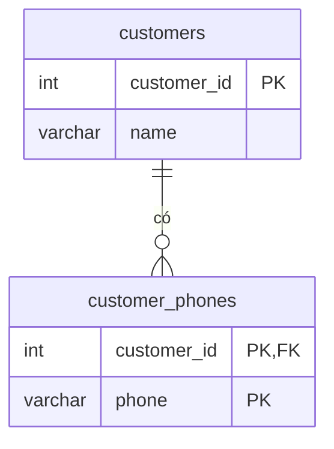

# 1NF: First Normal Form

> **Normalization** · [← Tổng quan](README.md)

**Definition:** Mỗi ô chỉ chứa **một giá trị** (atomic), không có **nhóm cột lặp lại**, và mỗi dòng được xác định duy nhất bởi primary key.

**Analogy:** Một cuốn danh bạ giấy ghi 3 số điện thoại của một người vào cùng một dòng, cách nhau bởi dấu phẩy. Muốn biết số 0912... là của ai, bạn phải dò từng dòng.

---

## 1. Problem

**Kiểu 1: nhiều giá trị nằm trong một ô.**

| customer_id | name | phones |
|---|---|---|
| 1 | An | 0901111111, 0912222222 |
| 2 | Bình | 0933333333 |

**Kiểu 2: nhóm cột lặp lại.**

| customer_id | name | phone1 | phone2 | phone3 |
|---|---|---|---|---|
| 1 | An | 0901111111 | 0912222222 | NULL |
| 2 | Bình | 0933333333 | NULL | NULL |

Vấn đề:
- **Tìm kiếm khó và sai:** phải viết `WHERE phones LIKE '%0912222222%'`, không dùng được index, và dễ khớp nhầm chuỗi con.
- **Cập nhật khó:** xóa một số phải xử lý chuỗi; với kiểu 2, phải xác định số đó nằm ở cột nào.
- **Không ràng buộc được:** không thể kiểm tra định dạng, `UNIQUE` hay foreign key cho **từng số**.
- **Kiểu 2 bị giới hạn cứng:** khách có số thứ 4 thì phải `ALTER TABLE`; phần lớn ô là `NULL`, và mọi query phải `OR` qua cả 3 cột.

## 2. Solution

Tách nhóm giá trị lặp lại ra **một bảng riêng**: **mỗi giá trị nằm trên một dòng**, có foreign key trỏ về bảng chính.



## 3. SQL

```sql
CREATE TABLE customers (
    customer_id INT PRIMARY KEY,       -- thực tế: GENERATED ALWAYS AS IDENTITY
    name        VARCHAR(100) NOT NULL
);

CREATE TABLE customer_phones (
    customer_id INT         NOT NULL REFERENCES customers (customer_id) ON DELETE CASCADE,
    phone       VARCHAR(15) NOT NULL CHECK (phone ~ '^0[0-9]{9}$'),   -- validate TỪNG số
    PRIMARY KEY (customer_id, phone)
);
CREATE INDEX ON customer_phones (phone);                -- tìm theo số điện thoại

INSERT INTO customers VALUES (1, 'An'), (2, 'Bình');
INSERT INTO customer_phones VALUES
    (1, '0901111111'),
    (1, '0912222222'),
    (2, '0933333333');

-- Tìm khách theo số điện thoại: so sánh chính xác, dùng được index
SELECT c.name
FROM customers c
JOIN customer_phones p USING (customer_id)
WHERE p.phone = '0912222222';
```

**Kết quả:** `An`

```sql
-- Thêm số thứ 4, thứ 5...: chỉ là một câu INSERT, không phải ALTER TABLE
INSERT INTO customer_phones VALUES (2, '0944444444');

-- Cần hiển thị dạng gộp? Hãy gộp lúc ĐỌC, đừng gộp lúc LƯU
SELECT c.name, string_agg(p.phone, ', ' ORDER BY p.phone) AS phones
FROM customers c
JOIN customer_phones p USING (customer_id)
GROUP BY c.customer_id, c.name
ORDER BY c.customer_id;
```

**Kết quả:**

| name | phones |
|---|---|
| An | 0901111111, 0912222222 |
| Bình | 0933333333, 0944444444 |

## 4. Trade-offs

| ✅ Được | ❌ Mất |
|---|---|
| Tìm kiếm chính xác, dùng được index | Thêm một bảng, và phải `JOIN` khi đọc |
| Ràng buộc được từng giá trị (`CHECK`, `UNIQUE`, `FOREIGN KEY`) | Muốn hiển thị dạng gộp thì phải dùng `string_agg` |
| Thêm hoặc xóa một giá trị chỉ cần một câu `INSERT`/`DELETE` | |
| Không giới hạn số lượng giá trị | |

**Ngoại lệ trong PostgreSQL:** Postgres có kiểu `ARRAY` và `JSONB`. Dùng được khi dữ liệu luôn được đọc và ghi **cả cụm**, không cần foreign key và không cần ràng buộc riêng cho từng phần tử, ví dụ `tags TEXT[]` kèm GIN index. Nếu cần foreign key hoặc constraint trên từng phần tử thì tách bảng.

**"Atomic" phụ thuộc vào use case:** `full_name` hay `address` có cần tách hay không tùy cách dữ liệu được truy vấn. Thường xuyên lọc theo tỉnh thành thì tách cột `province`; chỉ để hiển thị thì giữ nguyên.

## 5. Dấu hiệu vi phạm

- Cột chứa dữ liệu ngăn cách bởi `,` hoặc `;`, hoặc một chuỗi JSON lưu trong cột `VARCHAR`.
- Có các cột đánh số: `phone1`, `phone2`, `item1`, `item2`...
- Query dùng `LIKE '%...%'` trên một cột chứa danh sách.
- Code ứng dụng phải `split(",")` sau khi đọc dữ liệu ra.

## 6. Bài tập

Đưa bảng sau về 1NF, rồi viết câu query tính tổng số lượng sản phẩm của mỗi đơn.

| order_id | customer | products |
|---|---|---|
| 101 | An | Bàn phím x1, Chuột x2 |
| 102 | Bình | Màn hình x1 |

<details>
<summary><b>Xem đáp án</b></summary>

Mỗi sản phẩm trong đơn là một dòng, và số lượng được tách thành cột riêng:

```sql
CREATE TABLE orders (
    order_id INT PRIMARY KEY,
    customer VARCHAR(100) NOT NULL
);

CREATE TABLE order_items (
    order_id INT REFERENCES orders (order_id),
    product  VARCHAR(100),
    quantity INT NOT NULL CHECK (quantity > 0),
    PRIMARY KEY (order_id, product)
);

INSERT INTO orders VALUES (101, 'An'), (102, 'Bình');
INSERT INTO order_items VALUES (101, 'Bàn phím', 1), (101, 'Chuột', 2), (102, 'Màn hình', 1);

SELECT order_id, SUM(quantity) AS total_qty
FROM order_items
GROUP BY order_id
ORDER BY order_id;
```

**Kết quả:**

| order_id | total_qty |
|---|---|
| 101 | 3 |
| 102 | 1 |

Hai cột `customer` và `product` vẫn đang là text. Chúng sẽ được tách thành bảng riêng ở bước 2NF và 3NF, xem [bài tổng hợp](5-capstone.md).

</details>

---

[← Khái niệm nền tảng](0-khai-niem-nen-tang.md) · [Tổng quan](README.md) · [2NF →](2-2nf.md)
