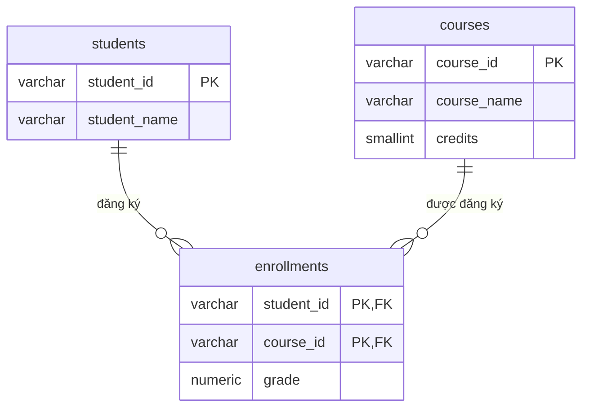

# 2NF: Second Normal Form

> **Normalization** · [← Tổng quan](README.md)

**Definition:** Bảng đạt 1NF, và mọi non-prime attribute phụ thuộc vào **toàn bộ** key, không chỉ vào một phần của key.

2NF chỉ cần xét khi bảng có **composite key**.

**Analogy:** Bảng điểm có mỗi dòng là một cặp (sinh viên, môn học) kèm điểm. Nếu ghi số tín chỉ vào từng dòng, môn có 200 sinh viên sẽ lặp số tín chỉ 200 lần, và đổi tín chỉ phải sửa cả 200 dòng.

---

## 1. Problem

Bảng `enrollments`, primary key là `(student_id, course_id)`:

| student_id | course_id | student_name | course_name | credits | grade |
|---|---|---|---|---|---|
| SV01 | CS101 | An | Cấu trúc dữ liệu | 3 | 8.5 |
| SV01 | CS102 | An | Cơ sở dữ liệu | 3 | 7.0 |
| SV02 | CS101 | Bình | Cấu trúc dữ liệu | 3 | 9.0 |

Các functional dependency:

| Phụ thuộc | Đánh giá |
|---|---|
| `(student_id, course_id) → grade` | ✅ phụ thuộc toàn bộ key |
| `student_id → student_name` | ❌ partial: chỉ phụ thuộc một phần key |
| `course_id → course_name, credits` | ❌ partial |

Các anomaly xảy ra:
- **Update:** đổi CS101 thành 4 tín chỉ phải sửa **mọi dòng** CS101; sót một dòng là dữ liệu mâu thuẫn.
- **Insert:** mở môn mới CS103 khi chưa có ai đăng ký thì **không thêm được**, vì `student_id` là một phần của primary key nên không được `NULL`.
- **Delete:** Bình rút môn CS101; vì đó là dòng duy nhất của Bình, thông tin về Bình **mất theo**.

## 2. Solution

1. Với mỗi nhóm cột chỉ phụ thuộc vào **một phần key**, tạo **bảng riêng** lấy phần key đó làm primary key.
2. Bảng gốc chỉ giữ lại những cột phụ thuộc vào **toàn bộ** key.



## 3. SQL

```sql
CREATE TABLE students (
    student_id   VARCHAR(10)  PRIMARY KEY,
    student_name VARCHAR(100) NOT NULL
);

CREATE TABLE courses (
    course_id   VARCHAR(10)  PRIMARY KEY,
    course_name VARCHAR(100) NOT NULL,
    credits     SMALLINT     NOT NULL CHECK (credits > 0)
);

CREATE TABLE enrollments (
    student_id VARCHAR(10) REFERENCES students (student_id),
    course_id  VARCHAR(10) REFERENCES courses (course_id),
    grade      NUMERIC(3, 1) CHECK (grade BETWEEN 0 AND 10),
    PRIMARY KEY (student_id, course_id)
);

INSERT INTO students VALUES ('SV01', 'An'), ('SV02', 'Bình');
INSERT INTO courses  VALUES ('CS101', 'Cấu trúc dữ liệu', 3), ('CS102', 'Cơ sở dữ liệu', 3);
INSERT INTO enrollments VALUES ('SV01', 'CS101', 8.5), ('SV01', 'CS102', 7.0), ('SV02', 'CS101', 9.0);

UPDATE courses SET credits = 4 WHERE course_id = 'CS101';      -- đổi tín chỉ: sửa đúng 1 dòng
INSERT INTO courses VALUES ('CS103', 'Mạng máy tính', 3);       -- mở môn chưa có ai đăng ký: OK

-- JOIN lại để có bảng như ban đầu
SELECT e.student_id, e.course_id, s.student_name, c.course_name, c.credits, e.grade
FROM enrollments e
JOIN students s USING (student_id)
JOIN courses  c USING (course_id)
ORDER BY e.student_id, e.course_id;
```

**Kết quả:** cả hai dòng CS101 cùng thấy 4 tín chỉ, vì giá trị này giờ chỉ nằm ở một nơi.

| student_id | course_id | student_name | course_name | credits | grade |
|---|---|---|---|---|---|
| SV01 | CS101 | An | Cấu trúc dữ liệu | 4 | 8.5 |
| SV01 | CS102 | An | Cơ sở dữ liệu | 3 | 7.0 |
| SV02 | CS101 | Bình | Cấu trúc dữ liệu | 4 | 9.0 |

Giờ nếu Bình rút môn (`DELETE FROM enrollments ...`), dữ liệu của Bình vẫn còn trong `students`.

## 4. Trade-offs

| ✅ Được | ❌ Mất |
|---|---|
| Mỗi fact chỉ lưu ở một nơi, sửa đúng một dòng | Phải `JOIN` khi đọc |
| Thêm sinh viên hay môn học độc lập, không cần có đăng ký trước | Nhiều bảng hơn |
| Xóa một đăng ký không làm mất sinh viên hay môn học | |
| Tiết kiệm dung lượng | |

> ⚠️ **Thêm cột `id` tự tăng không giải quyết được vi phạm 2NF.** `(student_id, course_id)` vẫn là candidate key, và `student_name` vẫn chỉ phụ thuộc vào một phần của nó. Dữ liệu dư thừa vẫn còn, chỉ bị che đi.

## 5. Dấu hiệu vi phạm

- Bảng có key ghép, và có những cột chỉ mô tả một thành phần của key, như tên sinh viên hay tên môn học.
- Cùng một giá trị bị lặp lại ở mọi dòng có chung một thành phần của key.

## 6. Bài tập

Bảng `order_items` có primary key là `(order_id, product_id)`. Cột `unit_price` là **giá bán của sản phẩm trong chính đơn đó**. Hãy tìm các partial dependency rồi tách bảng.

| order_id | product_id | order_date | customer_name | product_name | unit_price | quantity |
|---|---|---|---|---|---|---|
| 1 | KB01 | 2026-10-01 | An | Bàn phím | 800,000 | 1 |
| 1 | MS01 | 2026-10-01 | An | Chuột | 300,000 | 2 |
| 2 | MS01 | 2026-10-03 | Bình | Chuột | 280,000 | 1 |

Gợi ý: hãy cẩn thận với `unit_price`.

<details>
<summary><b>Xem đáp án</b></summary>

**Partial dependency:**
- `order_id → order_date, customer_name`
- `product_id → product_name`

**`unit_price` không phải partial dependency.** Cùng là MS01 nhưng đơn 1 bán giá 300k, đơn 2 bán giá 280k. Giá lúc bán phụ thuộc vào **cả** `(order_id, product_id)`. Đây là một fact riêng (*snapshot* giá tại thời điểm bán) nên giữ trong `order_items`; giá niêm yết hiện tại là fact khác, thuộc bảng `products`.

```sql
CREATE TABLE orders (
    order_id      INT  PRIMARY KEY,
    order_date    DATE NOT NULL,
    customer_name VARCHAR(100) NOT NULL       -- sẽ được tách tiếp ở bước 3NF
);

CREATE TABLE products (
    product_id   VARCHAR(10)   PRIMARY KEY,
    product_name VARCHAR(100)  NOT NULL,
    price        NUMERIC(12, 0) NOT NULL       -- giá niêm yết hiện tại
);

CREATE TABLE order_items (
    order_id   INT         REFERENCES orders (order_id),
    product_id VARCHAR(10) REFERENCES products (product_id),
    unit_price NUMERIC(12, 0) NOT NULL,         -- giá lúc bán: phụ thuộc cả key
    quantity   INT NOT NULL CHECK (quantity > 0),
    PRIMARY KEY (order_id, product_id)
);
```

</details>

---

[← 1NF](1-1nf.md) · [Tổng quan](README.md) · [3NF →](3-3nf.md)
