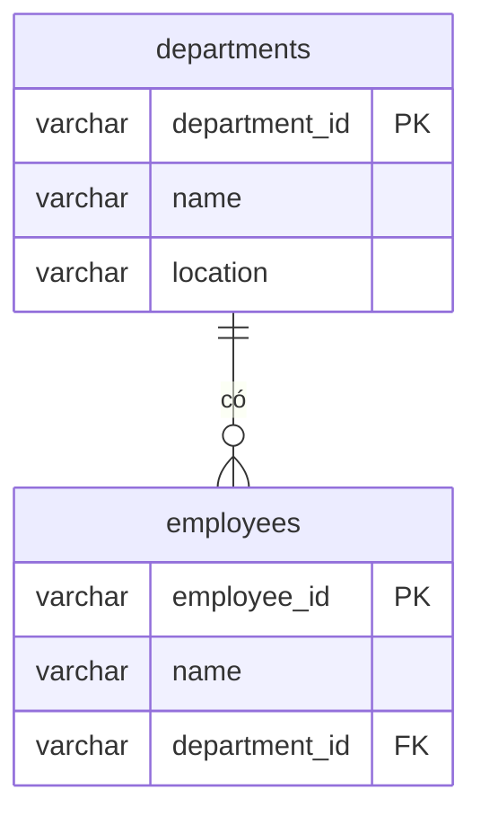

# 3NF: Third Normal Form

> **Normalization** · [← Tổng quan](README.md)

**Definition:** Bảng đạt 2NF, và **không non-prime attribute nào phụ thuộc vào một non-prime attribute khác**, tức là không có *transitive dependency*.

**Analogy:** Hồ sơ mỗi nhân viên đều ghi kèm phòng ban ở tầng mấy. Khi phòng chuyển tầng, phải sửa hồ sơ của cả phòng, vì thông tin đó thuộc về **phòng ban** chứ không thuộc về nhân viên.

---

## 1. Problem

Bảng `employees`, primary key là `employee_id`. Key chỉ có một cột nên bảng **tự động đạt 2NF**:

| employee_id | name | department_id | department_name | location |
|---|---|---|---|---|
| E01 | An | D1 | Kỹ thuật | Tầng 5 |
| E02 | Bình | D1 | Kỹ thuật | Tầng 5 |
| E03 | Chi | D2 | Kinh doanh | Tầng 3 |

Có một transitive dependency:

```
employee_id → department_id → department_name, location
              └─ không phải key ─┘
```

Các anomaly xảy ra:
- **Update:** phòng Kỹ thuật chuyển lên tầng 6 thì phải sửa **nhiều dòng**.
- **Insert:** tạo phòng Marketing khi chưa có nhân viên nào thì **không lưu được**.
- **Delete:** Chi nghỉ việc thì **mất luôn** thông tin về phòng Kinh doanh.

## 2. Solution

Tách phụ thuộc `department_id → department_name, location` ra bảng `departments`, với `department_id` là primary key. Bảng `employees` chỉ giữ lại `department_id` làm foreign key.



## 3. SQL

```sql
CREATE TABLE departments (
    department_id VARCHAR(5)   PRIMARY KEY,
    name          VARCHAR(100) NOT NULL,
    location      VARCHAR(50)  NOT NULL
);

CREATE TABLE employees (
    employee_id   VARCHAR(5)   PRIMARY KEY,
    name          VARCHAR(100) NOT NULL,
    department_id VARCHAR(5)   NOT NULL REFERENCES departments (department_id)
);

INSERT INTO departments VALUES ('D1', 'Kỹ thuật', 'Tầng 5'), ('D2', 'Kinh doanh', 'Tầng 3');
INSERT INTO employees   VALUES ('E01', 'An', 'D1'), ('E02', 'Bình', 'D1'), ('E03', 'Chi', 'D2');

UPDATE departments SET location = 'Tầng 6' WHERE department_id = 'D1';   -- sửa đúng 1 dòng
INSERT INTO departments VALUES ('D3', 'Marketing', 'Tầng 2');             -- phòng chưa có ai: OK
DELETE FROM employees WHERE employee_id = 'E03';                          -- Chi nghỉ: phòng D2 vẫn còn

SELECT d.department_id, d.name, d.location, count(e.employee_id) AS headcount
FROM departments d
LEFT JOIN employees e USING (department_id)
GROUP BY d.department_id, d.name, d.location
ORDER BY d.department_id;
```

**Kết quả:**

| department_id | name | location | headcount |
|---|---|---|---|
| D1 | Kỹ thuật | Tầng 6 | 2 |
| D2 | Kinh doanh | Tầng 3 | 0 |
| D3 | Marketing | Tầng 2 | 0 |

**Derived column cũng là transitive dependency.** Ví dụ `line_total` phụ thuộc vào `quantity` và `unit_price`, mà cả hai đều không phải key. Có 2 cách xử lý: tính lúc query, hoặc để PostgreSQL tự tính bằng *generated column*, nhờ vậy giá trị không bao giờ bị lệch:

```sql
CREATE TABLE order_lines (
    order_id   INT,
    line_no    INT,
    quantity   INT            NOT NULL,
    unit_price NUMERIC(12, 0) NOT NULL,
    line_total NUMERIC(14, 0) GENERATED ALWAYS AS (quantity * unit_price) STORED,
    PRIMARY KEY (order_id, line_no)
);

INSERT INTO order_lines (order_id, line_no, quantity, unit_price) VALUES (1, 1, 3, 300000);
UPDATE order_lines SET quantity = 5 WHERE order_id = 1 AND line_no = 1;
SELECT quantity, line_total FROM order_lines;        -- 5 | 1500000 (tự cập nhật)
```

## 4. Trade-offs

| ✅ Được | ❌ Mất |
|---|---|
| Thông tin của mỗi thực thể nằm đúng trong bảng của nó | Thêm `JOIN` khi đọc |
| Thêm, sửa, xóa từng thực thể độc lập với nhau | Nhiều bảng hơn |
| Không còn dữ liệu mâu thuẫn | |

> ⚠️ **Dữ liệu snapshot không vi phạm 3NF.** Địa chỉ giao hàng trong `orders` là fact khác với địa chỉ hiện tại trong `customers`: đó là *địa chỉ tại thời điểm đặt hàng*. Khách đổi địa chỉ thì đơn cũ **không được** đổi theo.

## 5. Dấu hiệu vi phạm

- Bảng chứa thuộc tính của một thực thể khác: tên phòng ban trong bảng nhân viên, tên nhà cung cấp trong bảng sản phẩm.
- Có các cột cùng tiền tố với một foreign key, ví dụ `department_id` đi kèm `department_name` và `department_location`.
- Có cột tính ra được từ các cột khác (`total`, `age` tính từ `birth_date`).
- Dependency dạng mã → tên: `province_code → province_name`.

## 6. Bài tập

Đưa bảng `books` (primary key là `isbn`) về 3NF.

| isbn | title | publisher_id | publisher_name | publisher_country |
|---|---|---|---|---|
| 978-0-13-235088-4 | Clean Code | P01 | Prentice Hall | USA |
| 978-0-13-468599-1 | The Pragmatic Programmer | P02 | Addison-Wesley | USA |
| 978-0-201-63361-0 | Design Patterns | P02 | Addison-Wesley | USA |

<details>
<summary><b>Xem đáp án</b></summary>

Bảng có transitive dependency `isbn → publisher_id → publisher_name, publisher_country`. Tách nhà xuất bản ra bảng riêng:

```sql
CREATE TABLE publishers (
    publisher_id VARCHAR(5)   PRIMARY KEY,
    name         VARCHAR(100) NOT NULL,
    country      VARCHAR(50)  NOT NULL
);

CREATE TABLE books (
    isbn         VARCHAR(17)  PRIMARY KEY,
    title        VARCHAR(200) NOT NULL,
    publisher_id VARCHAR(5)   NOT NULL REFERENCES publishers (publisher_id)
);

INSERT INTO publishers VALUES ('P01', 'Prentice Hall', 'USA'), ('P02', 'Addison-Wesley', 'USA');
INSERT INTO books VALUES
    ('978-0-13-235088-4', 'Clean Code', 'P01'),
    ('978-0-13-468599-1', 'The Pragmatic Programmer', 'P02'),
    ('978-0-201-63361-0', 'Design Patterns', 'P02');

SELECT b.title, p.name AS publisher
FROM books b
JOIN publishers p USING (publisher_id)
ORDER BY b.title;
```

</details>

---

[← 2NF](2-2nf.md) · [Tổng quan](README.md) · [BCNF →](4-bcnf.md)
