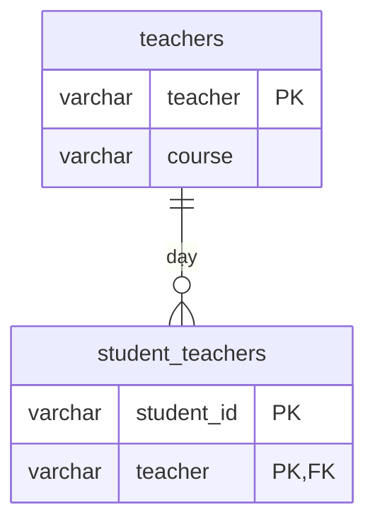

# BCNF: Boyce–Codd Normal Form

> **Normalization** · [← Tổng quan](README.md)

**Definition:** Với mọi functional dependency **A → B**, A phải là **super key**. Nói cách khác, **chỉ key mới được làm determinant**.

BCNF là phiên bản chặt hơn của 3NF. Hai dạng chuẩn này chỉ khác nhau khi bảng có **nhiều composite candidate key chồng lấn nhau** (có chung cột).

**Analogy:** Trường quy định "mỗi giảng viên chỉ dạy một môn". Nếu quy định này chỉ thể hiện rải rác trong danh sách lớp thay vì được lưu ở một nơi riêng, một lần ghi sai là đủ phá vỡ nó mà không ai phát hiện.

---

## 1. Problem

Quy tắc nghiệp vụ:
1. Mỗi giảng viên chỉ dạy **1 môn**: `teacher → course`.
2. Mỗi môn có **nhiều** giảng viên.
3. Mỗi sinh viên học một môn với **đúng 1** giảng viên: `(student_id, course) → teacher`.

| student_id | course | teacher |
|---|---|---|
| SV01 | CSDL | Hùng |
| SV02 | CSDL | Hùng |
| SV03 | CSDL | Lan |
| SV01 | Mạng | Mai |

- **Candidate key:** `(student_id, course)` và `(student_id, teacher)`.
- **Bảng có đạt 3NF không?** Có. Định nghĩa 3NF cho phép A → B khi B là *prime attribute*. Ở đây `course` là prime, vì nó nằm trong key `(student_id, course)`, nên vẫn thỏa 3NF.
- **Bảng có đạt BCNF không?** Không, vì có `teacher → course` mà `teacher` **không phải super key**.

Các anomaly xảy ra:
- **Update:** thầy Hùng chuyển sang dạy Mạng phải sửa nhiều dòng; sót một dòng là thầy Hùng "dạy 2 môn", vi phạm quy tắc 1.
- **Insert:** cô Hoa mới về dạy CSDL nhưng chưa có sinh viên nào, nên **không lưu được** thông tin "cô Hoa dạy CSDL".
- **Delete:** SV03 rút môn thì **mất luôn** thông tin "cô Lan dạy CSDL".

## 2. Solution

Tách theo phụ thuộc vi phạm `teacher → course`:
- `teachers(teacher PK, course)`: lưu quy tắc "mỗi giảng viên dạy 1 môn" ở **đúng một nơi**.
- `student_teachers(student_id, teacher)`: sinh viên học với giảng viên nào. Môn học suy ra được qua giảng viên.



## 3. SQL

```sql
CREATE TABLE teachers (
    teacher VARCHAR(50) PRIMARY KEY,      -- thực tế nên dùng mã giảng viên
    course  VARCHAR(50) NOT NULL
);

CREATE TABLE student_teachers (
    student_id VARCHAR(10),
    teacher    VARCHAR(50) REFERENCES teachers (teacher),
    PRIMARY KEY (student_id, teacher)
);

INSERT INTO teachers VALUES ('Hùng', 'CSDL'), ('Lan', 'CSDL'), ('Mai', 'Mạng'),
                            ('Hoa', 'CSDL');          -- chưa có sinh viên nào: vẫn lưu được
INSERT INTO student_teachers VALUES ('SV01', 'Hùng'), ('SV02', 'Hùng'), ('SV03', 'Lan'), ('SV01', 'Mai');

SELECT st.student_id, t.course, st.teacher
FROM student_teachers st
JOIN teachers t USING (teacher)
ORDER BY st.student_id, t.course;
```

**Kết quả:** JOIN lại ra đúng bảng ban đầu.

| student_id | course | teacher |
|---|---|---|
| SV01 | CSDL | Hùng |
| SV01 | Mạng | Mai |
| SV02 | CSDL | Hùng |
| SV03 | CSDL | Lan |

**⚠️ Đổi lại:** quy tắc 3 (mỗi sinh viên học một môn với 1 giảng viên) **không còn được database kiểm tra**:

```sql
INSERT INTO student_teachers VALUES ('SV01', 'Lan');   -- ✅ chạy được, nhưng SAI nghiệp vụ:
                                                       -- SV01 giờ học CSDL với cả Hùng lẫn Lan
```

## 4. Trade-offs

| ✅ Được | ❌ Mất |
|---|---|
| Hết dư thừa: mỗi quy tắc nằm ở một nơi | **Có thể mất ràng buộc** (*dependency preservation*): quy tắc trải trên 2 bảng không thể kiểm tra bằng constraint của một bảng |
| Hết anomaly khi thêm, sửa, xóa | Phải kiểm tra bằng trigger hoặc ở tầng ứng dụng |

Đây là khác biệt lý thuyết quan trọng giữa hai dạng chuẩn: **luôn có cách tách về 3NF mà vẫn giữ mọi ràng buộc, còn BCNF thì không phải lúc nào cũng làm được.**

**Giải pháp trung gian trong PostgreSQL:** cố ý giữ lại cột `course` trong bảng con, và **để database đảm bảo tính nhất quán** bằng composite foreign key:

```sql
CREATE TABLE teachers (
    teacher VARCHAR(50) PRIMARY KEY,
    course  VARCHAR(50) NOT NULL,
    UNIQUE (teacher, course)                  -- để bảng con tham chiếu được cặp này
);

CREATE TABLE student_teachers (
    student_id VARCHAR(10),
    teacher    VARCHAR(50),
    course     VARCHAR(50),                   -- lặp lại có kiểm soát: FK bảo đảm luôn khớp
    PRIMARY KEY (student_id, teacher),
    UNIQUE (student_id, course),              -- ✅ quy tắc 3 được kiểm tra lại
    FOREIGN KEY (teacher, course) REFERENCES teachers (teacher, course) ON UPDATE CASCADE
);

INSERT INTO teachers VALUES ('Hùng', 'CSDL'), ('Lan', 'CSDL');
INSERT INTO student_teachers VALUES ('SV01', 'Hùng', 'CSDL');
-- INSERT INTO student_teachers VALUES ('SV01', 'Lan', 'CSDL');
--   → ❌ ERROR: duplicate key value violates unique constraint
```

**In practice:** phần lớn bảng đạt 3NF cũng đã đạt BCNF. Chỉ cần kiểm tra kỹ khi bảng có nhiều composite candidate key chồng lấn nhau.

## 5. Dấu hiệu vi phạm

- Bảng có từ 2 composite candidate key trở lên, và các key này có chung cột.
- Có quy tắc nghiệp vụ dạng "mỗi X chỉ thuộc 1 Y", trong khi X không phải key của bảng nào.

## 6. Bài tập

Quy tắc:
- Mỗi bác sĩ thuộc **1 khoa**.
- Mỗi khoa có nhiều bác sĩ.
- Mỗi bệnh nhân khám tại một khoa với **đúng 1** bác sĩ.

| patient_id | department | doctor |
|---|---|---|
| BN01 | Tim mạch | BS. Nam |
| BN02 | Tim mạch | BS. Nam |
| BN03 | Tim mạch | BS. Thu |
| BN01 | Da liễu | BS. Hà |

1. Liệt kê các candidate key.
2. Bảng có đạt 3NF không? Có đạt BCNF không?
3. Tách về BCNF. Sau khi tách, ràng buộc nào bị mất?

<details>
<summary><b>Xem đáp án</b></summary>

1. **Candidate key:** `(patient_id, department)` và `(patient_id, doctor)`.
2. **Đạt 3NF**, vì mọi cột đều là prime attribute. **Không đạt BCNF**, vì có `doctor → department` mà `doctor` không phải super key.
3. **Tách thành 2 bảng:**

```sql
CREATE TABLE doctors (
    doctor     VARCHAR(50) PRIMARY KEY,
    department VARCHAR(50) NOT NULL
);

CREATE TABLE visits (
    patient_id VARCHAR(10),
    doctor     VARCHAR(50) REFERENCES doctors (doctor),
    PRIMARY KEY (patient_id, doctor)
);

INSERT INTO doctors VALUES ('BS. Nam', 'Tim mạch'), ('BS. Thu', 'Tim mạch'), ('BS. Hà', 'Da liễu');
INSERT INTO visits VALUES ('BN01', 'BS. Nam'), ('BN02', 'BS. Nam'), ('BN03', 'BS. Thu'), ('BN01', 'BS. Hà');
```

**Ràng buộc bị mất:** quy tắc "mỗi bệnh nhân khám một khoa với đúng 1 bác sĩ". Bây giờ BN01 có thể được thêm cả BS. Nam lẫn BS. Thu, dù cả hai cùng khoa Tim mạch. Nếu cần giữ quy tắc này, dùng giải pháp trung gian ở mục 4: thêm cột `department`, khai báo `UNIQUE (patient_id, department)` và composite foreign key.

</details>

---

[← 3NF](3-3nf.md) · [Tổng quan](README.md) · [Bài tổng hợp →](5-capstone.md)
