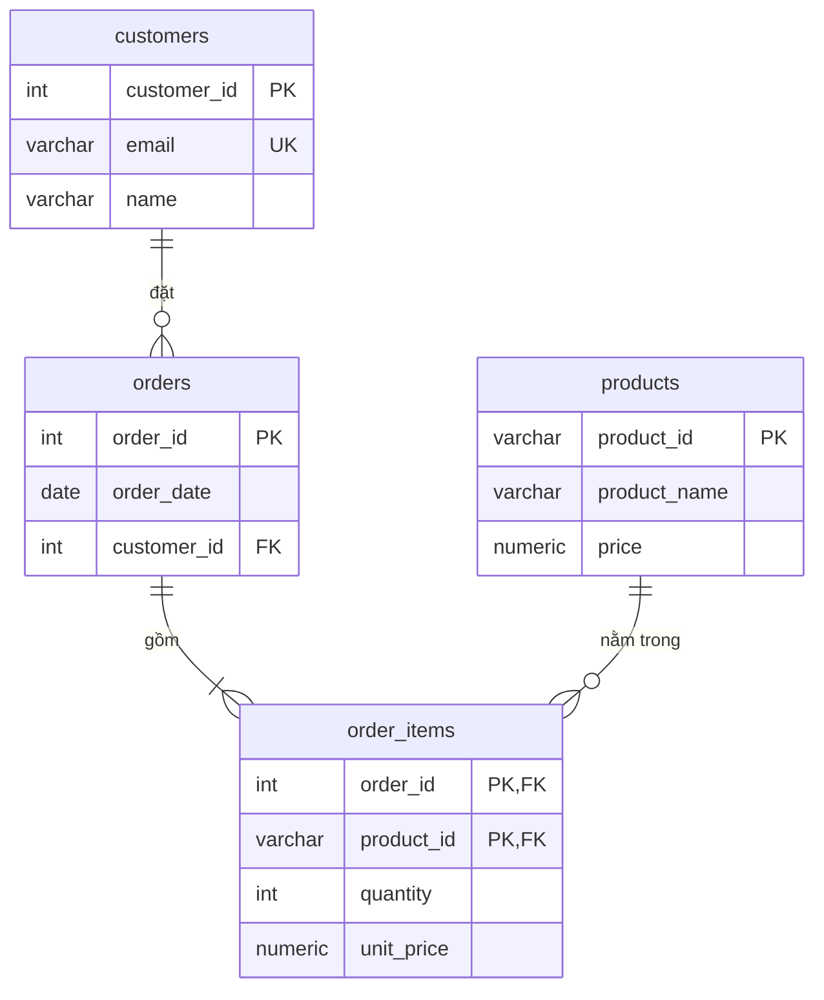

# Bài tổng hợp: chuẩn hóa một bảng đơn hàng xuất từ Excel

> **Normalization** · [← Tổng quan](README.md)

Bài này lấy một file đơn hàng do bộ phận bán hàng quản lý bằng Excel và đưa nó lần lượt qua **0NF → 1NF → 2NF → 3NF → kiểm tra BCNF**.

---

## Bảng ban đầu (0NF)

| order_id | order_date | customer_email | customer_name | items |
|---|---|---|---|---|
| 1001 | 2026-10-01 | an@example.com | An | KB01 Bàn phím (800,000) x1; MS01 Chuột (300,000) x2 |
| 1002 | 2026-10-02 | binh@example.com | Bình | MN01 Màn hình (3,000,000) x1 |
| 1003 | 2026-10-05 | an@example.com | An | MS01 Chuột (300,000) x1 |

Các vấn đề:
- Cột `items` chứa **nhiều sản phẩm** trong một ô, và mỗi sản phẩm lại gộp cả mã, tên, giá và số lượng.
- Thông tin khách An bị **lặp lại** ở 2 đơn.
- Tên và giá sản phẩm bị **lặp lại** trong từng đơn.

---

## Bước 1 → 1NF: mỗi ô một giá trị

Tách mỗi sản phẩm trong đơn thành **một dòng**, và mỗi thông tin thành **một cột**. Primary key là `(order_id, product_id)`.

| order_id | product_id | order_date | customer_email | customer_name | product_name | unit_price | quantity |
|---|---|---|---|---|---|---|---|
| 1001 | KB01 | 2026-10-01 | an@example.com | An | Bàn phím | 800,000 | 1 |
| 1001 | MS01 | 2026-10-01 | an@example.com | An | Chuột | 300,000 | 2 |
| 1002 | MN01 | 2026-10-02 | binh@example.com | Bình | Màn hình | 3,000,000 | 1 |
| 1003 | MS01 | 2026-10-05 | an@example.com | An | Chuột | 300,000 | 1 |

Bảng đã đạt 1NF, nhưng dư thừa còn nhiều hơn trước: thông tin khách và thông tin đơn bị lặp theo từng sản phẩm.

## Bước 2 → 2NF: bỏ partial dependency

| Phụ thuộc | Loại | Xử lý |
|---|---|---|
| `order_id → order_date, customer_email, customer_name` | ❌ partial | Tách ra bảng `orders` |
| `product_id → product_name, price` | ❌ partial | Tách ra bảng `products` |
| `(order_id, product_id) → quantity, unit_price` | ✅ full | Giữ lại trong `order_items` |

> Trong dữ liệu, MS01 ở cả 2 đơn đều có giá 300k, nhìn như có FD `product_id → unit_price`. Nhưng theo **quy tắc nghiệp vụ**, giá thay đổi theo thời gian, còn đơn cũ phải giữ đúng giá lúc bán. Vì vậy `unit_price` phụ thuộc vào cả key. Đây là lý do [functional dependency phải lấy từ nghiệp vụ, không lấy từ dữ liệu](0-khai-niem-nen-tang.md#2-functional-dependency-phụ-thuộc-hàm).

Kết quả:
- `orders(order_id PK, order_date, customer_email, customer_name)`
- `products(product_id PK, product_name, price)`
- `order_items(order_id, product_id, quantity, unit_price)`, với primary key là `(order_id, product_id)`

## Bước 3 → 3NF: bỏ transitive dependency

Trong bảng `orders` có transitive dependency `order_id → customer_email → customer_name`, tức là thông tin khách hàng nằm trong bảng đơn hàng.

Tách ra bảng `customers`. Dùng **surrogate key** `customer_id` làm primary key, vì email có thể thay đổi; email vẫn được khai báo `UNIQUE`.

- `customers(customer_id PK, email UNIQUE, name)`
- `orders(order_id PK, order_date, customer_id FK)`

## Bước 4: kiểm tra BCNF

| Bảng | Functional dependency | Determinant là key? |
|---|---|---|
| customers | `customer_id → email, name`; `email → customer_id, name` | ✅ cả hai đều là candidate key |
| products | `product_id → product_name, price` | ✅ |
| orders | `order_id → order_date, customer_id` | ✅ |
| order_items | `(order_id, product_id) → quantity, unit_price` | ✅ |

Mọi determinant đều là key, nên **cả 4 bảng đều đạt BCNF**.

---

## Schema cuối cùng



```sql
CREATE TABLE customers (
    customer_id INT GENERATED ALWAYS AS IDENTITY PRIMARY KEY,
    email       VARCHAR(255) NOT NULL UNIQUE,
    name        VARCHAR(100) NOT NULL
);

CREATE TABLE products (
    product_id   VARCHAR(10)    PRIMARY KEY,
    product_name VARCHAR(100)   NOT NULL,
    price        NUMERIC(12, 0) NOT NULL CHECK (price >= 0)   -- tiền: dùng NUMERIC, không dùng FLOAT
);

CREATE TABLE orders (
    order_id    INT  PRIMARY KEY,
    order_date  DATE NOT NULL,
    customer_id INT  NOT NULL REFERENCES customers (customer_id)
);

CREATE TABLE order_items (
    order_id   INT            REFERENCES orders (order_id) ON DELETE CASCADE,
    product_id VARCHAR(10)    REFERENCES products (product_id),
    quantity   INT            NOT NULL CHECK (quantity > 0),
    unit_price NUMERIC(12, 0) NOT NULL,      -- giá lúc bán, KHÔNG phải bản sao của products.price
    PRIMARY KEY (order_id, product_id)
);

INSERT INTO customers (email, name) VALUES ('an@example.com', 'An'), ('binh@example.com', 'Bình');
INSERT INTO products VALUES ('KB01', 'Bàn phím', 800000), ('MS01', 'Chuột', 300000), ('MN01', 'Màn hình', 3000000);
INSERT INTO orders VALUES (1001, '2026-10-01', 1), (1002, '2026-10-02', 2), (1003, '2026-10-05', 1);
INSERT INTO order_items VALUES
    (1001, 'KB01', 1, 800000),
    (1001, 'MS01', 2, 300000),
    (1002, 'MN01', 1, 3000000),
    (1003, 'MS01', 1, 300000);
```

**Dựng lại báo cáo giống file Excel ban đầu:**

```sql
SELECT o.order_id,
       o.order_date,
       c.name AS customer,
       string_agg(p.product_name || ' x' || oi.quantity, '; ' ORDER BY p.product_id) AS items,
       SUM(oi.quantity * oi.unit_price) AS total
FROM orders o
JOIN customers   c  USING (customer_id)
JOIN order_items oi USING (order_id)
JOIN products    p  USING (product_id)
GROUP BY o.order_id, o.order_date, c.name
ORDER BY o.order_id;
```

**Kết quả:**

| order_id | order_date | customer | items | total |
|---|---|---|---|---|
| 1001 | 2026-10-01 | An | Bàn phím x1; Chuột x2 | 1400000 |
| 1002 | 2026-10-02 | Bình | Màn hình x1 | 3000000 |
| 1003 | 2026-10-05 | An | Chuột x1 | 300000 |

---

## Khi có thay đổi: anomaly đã biến mất

```sql
UPDATE customers SET email = 'an.nguyen@example.com' WHERE customer_id = 1;  -- sửa 1 dòng, mọi đơn của An đều thấy
UPDATE products SET price = 350000 WHERE product_id = 'MS01';                 -- giá mới, đơn cũ giữ giá lúc bán
INSERT INTO products VALUES ('HP01', 'Tai nghe', 1200000);                    -- sản phẩm chưa ai mua: OK
DELETE FROM orders WHERE order_id = 1002;                                     -- Bình vẫn còn trong customers

SELECT (SELECT count(*) FROM customers) AS customers,
       (SELECT SUM(quantity * unit_price) FROM order_items WHERE order_id = 1003) AS order_1003_total;
```

**Kết quả:**

| customers | order_1003_total |
|---|---|
| 2 | 300000 |

| Thay đổi | Ở file Excel | Sau khi chuẩn hóa |
|---|---|---|
| An đổi email | Sửa mọi dòng của An, dễ sót | Sửa **1 dòng** |
| Tăng giá chuột | Đơn cũ và đơn mới lẫn lộn giá | Sửa `products.price`, đơn cũ vẫn giữ `unit_price` |
| Thêm sản phẩm chưa bán | Không có chỗ để ghi | `INSERT` vào `products` |
| Hủy đơn 1002 | Mất luôn thông tin khách Bình | Bình vẫn còn trong `customers` |

## Tóm tắt các bước

| Bước | Làm gì | Bảng thu được |
|---|---|---|
| 0NF → 1NF | Tách giá trị đa trị ra từng dòng | 1 bảng, key ghép `(order_id, product_id)` |
| 1NF → 2NF | Bỏ partial dependency | `orders`, `products`, `order_items` |
| 2NF → 3NF | Bỏ transitive dependency | Thêm `customers` |
| Kiểm tra BCNF | Mọi determinant đều là key | Đạt, không cần tách thêm |

---

[← BCNF](4-bcnf.md) · [Tổng quan](README.md)
