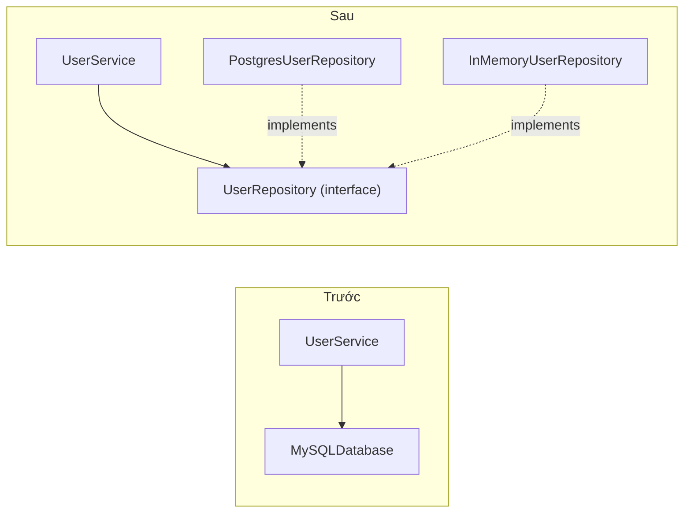

# D: Dependency Inversion Principle (DIP)

> **SOLID** · [← Tổng quan SOLID](README.md)

**Definition:** Module cấp cao (nghiệp vụ) **không phụ thuộc** vào module cấp thấp (database, email, API). **Cả hai cùng phụ thuộc vào abstraction.**

Hai ý chính:
1. Code nghiệp vụ chỉ biết interface, ví dụ `UserRepository`, chứ không biết `PostgresUserRepository`.
2. Interface do **phía nghiệp vụ định nghĩa** theo nhu cầu của mình, và phần hạ tầng phải implement theo.

**Analogy:** Đèn và laptop không hàn dây thẳng vào đường điện trong tường mà cắm qua **ổ cắm theo chuẩn chung**. Đổi đèn hay đổi nhà cung cấp điện đều không phải đục tường.

> **DIP khác DI:** DIP (Dependency *Inversion*) là **nguyên lý**. DI (Dependency *Injection*), tức là truyền dependency từ ngoài vào qua constructor, là **kỹ thuật** phổ biến nhất để thực hiện DIP.

---

## 1. Problem

```python
class UserService:
    def __init__(self):
        self.db = MySQLDatabase("mysql://...")       # tự tạo class cụ thể → tight coupling với MySQL
        self.mailer = SmtpMailer("smtp.gmail.com")    # tight coupling với SMTP

    def register(self, email: str):
        if self.db.query("SELECT ... WHERE email = %s", email):
            raise ValueError("Email đã tồn tại")
        self.db.execute("INSERT ...", email)
        self.mailer.send(email, "Chào mừng!")
```

- Đổi sang PostgreSQL hay MongoDB thì phải **sửa code nghiệp vụ**, dù quy tắc nghiệp vụ không đổi.
- Unit test `register()` cần **MySQL và SMTP thật**: chậm, khó setup, và có nguy cơ gửi mail thật.

## 2. Solution

1. Phía nghiệp vụ định nghĩa **abstraction** theo đúng nhu cầu của mình: `UserRepository` cần `exists()` và `add()`, `Mailer` cần `send()`.
2. `UserService` **nhận** các abstraction đó qua constructor (DI), không tự tạo.
3. Lớp hạ tầng (Postgres, SMTP) **implement** abstraction.
4. Ở **composition root** (hàm `main`, file khởi tạo app) mới quyết định lắp class cụ thể nào vào.

Chiều phụ thuộc bị **đảo ngược**: trước đây nghiệp vụ phụ thuộc vào hạ tầng, giờ hạ tầng phụ thuộc vào interface của nghiệp vụ.



## 3. Code

```python
from typing import Protocol


# ----- Abstraction: do tầng nghiệp vụ định nghĩa theo nhu cầu của mình -----
class UserRepository(Protocol):
    def exists(self, email: str) -> bool: ...
    def add(self, email: str) -> None: ...


class Mailer(Protocol):
    def send(self, to: str, subject: str) -> None: ...


# ----- High-level: chỉ biết abstraction, không biết Postgres hay SMTP -----
class UserService:
    def __init__(self, repo: UserRepository, mailer: Mailer):   # nhận từ ngoài vào (DI)
        self.repo = repo
        self.mailer = mailer

    def register(self, email: str) -> None:
        if self.repo.exists(email):
            raise ValueError(f"{email} đã tồn tại")
        self.repo.add(email)
        self.mailer.send(email, "Chào mừng bạn!")


# ----- Low-level: chi tiết hạ tầng, implement abstraction -----
class PostgresUserRepository:
    def __init__(self, dsn: str):
        self.dsn = dsn                          # thực tế: tạo connection pool ở đây

    def exists(self, email):
        print(f"🐘 Postgres: kiểm tra {email}")
        return False

    def add(self, email):
        print(f"🐘 Postgres: lưu {email}")


class SmtpMailer:
    def send(self, to, subject):
        print(f"📧 SMTP → {to}: {subject}")


# ----- Composition root: nơi DUY NHẤT biết lắp class cụ thể nào -----
service = UserService(PostgresUserRepository("postgresql://..."), SmtpMailer())
service.register("an@example.com")
# 🐘 Postgres: kiểm tra an@example.com
# 🐘 Postgres: lưu an@example.com
# 📧 SMTP → an@example.com: Chào mừng bạn!


# ----- Unit test: thay bằng fake, không cần DB hay SMTP thật -----
class InMemoryUserRepository:
    def __init__(self):
        self.emails: set[str] = set()

    def exists(self, email):
        return email in self.emails

    def add(self, email):
        self.emails.add(email)


class FakeMailer:
    def __init__(self):
        self.sent: list[str] = []

    def send(self, to, subject):
        self.sent.append(to)


def test_register_sends_welcome_email():
    repo, mailer = InMemoryUserRepository(), FakeMailer()
    UserService(repo, mailer).register("binh@example.com")
    assert repo.exists("binh@example.com")
    assert mailer.sent == ["binh@example.com"]

test_register_sends_welcome_email()
print("✅ Test pass, không cần database")
```

## 4. Trade-offs

| ✅ Được | ❌ Mất |
|---|---|
| Đổi hạ tầng (DB, nhà cung cấp email) không phải sửa nghiệp vụ | Thêm interface, và phải lắp ráp ở composition root |
| Unit test nhanh nhờ dùng fake | "Go to definition" dẫn tới interface thay vì implementation, khó trace hơn |
| Nghiệp vụ là trung tâm, hạ tầng chỉ là "plugin" (nền tảng của Clean/Hexagonal Architecture) | Interface chỉ có 1 implementation và không bao giờ có thêm là abstraction thừa |

**In practice:** chỉ áp dụng DIP cho những thứ **hay thay đổi hoặc khó test**, tức là I/O như database, network, file, email, thời gian (`now()`). Không cần áp dụng cho thư viện ổn định như `json` hay `math`.

## 5. Code smells & related patterns

**Code smells:**
- `__init__` tự tạo database, HTTP client hoặc SDK cụ thể.
- File nghiệp vụ import thẳng driver DB hay SDK bên thứ 3.
- Test phải `mock.patch` khắp nơi, hoặc không chạy được nếu thiếu DB thật.
- Dùng biến global hoặc [Singleton](../01-creational/singleton.md) để lấy dependency.

**Related patterns:**
- [Adapter](../02-structural/adapter.md): implementation cụ thể thường là một adapter bọc thư viện ngoài cho khớp với interface của nghiệp vụ.
- [Decorator](../02-structural/decorator.md) gắn được vào giữa chỉ vì nghiệp vụ phụ thuộc vào interface.
- Framework hỗ trợ DI: `Depends()` của FastAPI, pytest fixtures, container của Spring và NestJS.

## 6. Bài tập

Refactor để test được nhánh "nhớ mang ô" mà **không gọi network thật**.

```python
import requests


class WeatherReport:
    def today(self, city: str) -> str:
        data = requests.get(f"https://api.weather.com/{city}").json()
        return f"{city}: {data['temp']}°C" + (", nhớ mang ô" if data["rain"] else "")
```

<details>
<summary><b>Xem đáp án</b></summary>

Tách phần gọi mạng ra sau một abstraction `WeatherProvider`, rồi inject nó vào `WeatherReport`:

```python
from typing import Protocol


class WeatherProvider(Protocol):
    def fetch(self, city: str) -> dict: ...


class HttpWeatherProvider:                  # chi tiết hạ tầng: gọi mạng thật
    def fetch(self, city):
        import requests
        return requests.get(f"https://api.weather.com/{city}", timeout=5).json()


class WeatherReport:                        # nghiệp vụ: chỉ biết WeatherProvider
    def __init__(self, provider: WeatherProvider):
        self.provider = provider

    def today(self, city: str) -> str:
        data = self.provider.fetch(city)
        return f"{city}: {data['temp']}°C" + (", nhớ mang ô" if data["rain"] else "")


# Test: dùng fake trả dữ liệu cố định
class FakeProvider:
    def fetch(self, city):
        return {"temp": 26, "rain": True}


assert WeatherReport(FakeProvider()).today("Hanoi") == "Hanoi: 26°C, nhớ mang ô"

# Production: report = WeatherReport(HttpWeatherProvider())
```

</details>

---

[← I: Interface Segregation](4-interface-segregation.md) · [Tổng quan SOLID](README.md) · [Bài tổng hợp →](6-capstone.md)
